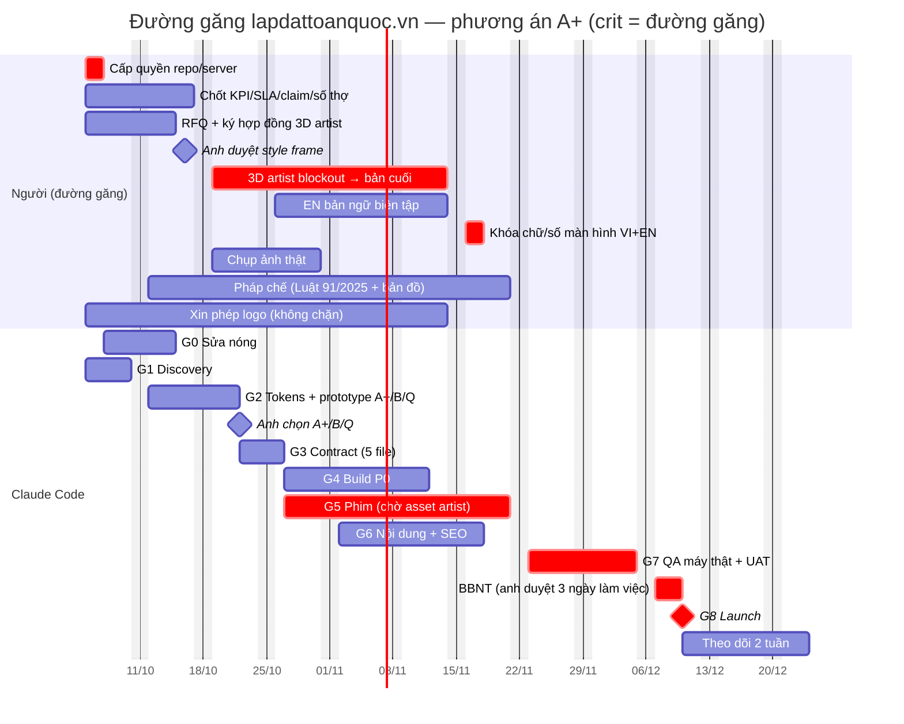

# 04 — Kế hoạch phát triển lapdattoanquoc.vn bằng Claude Code

> Dự án: website Bluebolt Services (CÔNG TY CỔ PHẦN CÔNG NGHỆ TIA CHỚP XANH) · Chủ dự án: anh Duy
> Người đọc: anh Duy (chốt phạm vi, ngân sách, duyệt) · dev vận hành Claude Code (thực thi)
> Ngày: 01/10/2026 · Phiên bản 1.1 (sau vòng phản biện: hiệu năng-mobile, SEO-pháp lý, ước lượng-quy trình, sáng tạo-kinh doanh) · Trạng thái: **ĐỀ XUẤT, chưa duyệt**
> Bám theo: `03-DINH-HUONG-THIET-KE-3D.md` (concept "Bluebolt Cinematic", v2.1) và `prototype/` (README, `MEASUREMENTS.md`, `shots/`).
> Mọi đường dẫn bằng chứng tính từ `/home/bbsw/WorkspaceDuy/LapDatToanQuoc/`.

---

## Mục lục

1. [Tóm tắt và các mốc dừng được](#1-tóm-tắt-và-các-mốc-dừng-được)
2. [Stack và kiến trúc](#2-stack-và-kiến-trúc)
3. [Pipeline sản xuất cảnh và video mobile](#3-pipeline-sản-xuất-cảnh-và-video-mobile)
4. [Các giai đoạn G0 → G9](#4-các-giai-đoạn-g0--g9)
5. [Ước lượng tổng, đường găng, lịch theo tuần](#5-ước-lượng-tổng-đường-găng-lịch-theo-tuần)
6. [Vận hành Claude Code](#6-vận-hành-claude-code)
7. [NFR và tiêu chí nghiệm thu](#7-nfr-và-tiêu-chí-nghiệm-thu)
8. [Rủi ro và giảm thiểu](#8-rủi-ro-và-giảm-thiểu)
9. [Quyết định anh Duy cần chốt](#9-quyết-định-anh-duy-cần-chốt)

---

## 1. Tóm tắt và các mốc dừng được

### 1.1 Tóm tắt trong 1 phút

- **Thứ anh muốn là ngôn ngữ điện ảnh của video quảng cáo**, không phải bố cục hay màu của site mddecorpro.com. Video là **một cú máy quay tay góc nhìn người đang ngồi (POV)**: laptop và tay ở tiền cảnh, màn hình lớn phía sau, **phòng sáng ban ngày**. Máy vòng từ chéo về chính diện và tiến lại. Khi màn hình chiếm gần hết khung thì **phòng tối dần** (điện thoại tự hạ phơi sáng, đo được độ sáng phòng giảm ~50%). Sau đó **máy giữ khung, website cuộn ngay trên màn hình** suốt ~40 giây (`02` mục A2–A3, `research/tiktok/sheets/camera_0-8s.jpg`). Đưa lên web thành: **người dùng cuộn = máy quay di chuyển**, rồi website cuộn trong màn hình, rồi chuyển giao sang HTML thật.
- **Prototype đã chứng minh phần kỹ thuật làm được** (`prototype/`):
  - Cuộn từ khung rộng chéo góc tới lúc màn hình lấp khung, rồi hòa sang hero HTML thật. Hai lớp chồng gần như trùng khít (sai khác trung bình 3,3/255).
  - Mobile không chạy WebGL: phát video dựng từ chính cảnh đó, cuộn để tua (50% cuộn ↔ giây 2,30, đúng công thức).
  - Reduced-motion: chỉ hiện poster tĩnh, không tải three.js.
  - Xem `prototype/shots/sheet.jpg` và `prototype/demo-desktop.mp4`.
- **Prototype chưa bắt được tinh thần của video, và chưa đạt hiệu năng.** Vòng phản biện chỉ ra (đã nhận, sửa ở G2):
  - Khung đầu là diorama ban đêm nhìn từ cao (máy 1,44 m), có mascot. Video là POV ngồi, ban ngày, phòng chỉ tối khi màn hình chiếm khung. Prototype giữ phơi sáng cố định.
  - Prototype **bỏ mất pha "giữ khung, website cuộn trên màn hình"**, tức đỉnh cảm xúc của video. Vừa lấp khung là sang ngay một hero HTML phẳng.
  - Màn đầu không có H1 hay CTA B2B. H1 nằm trong lớp đang `opacity:0` tới 80% đoạn cuộn 420vh. Đây là lỗi SEO và a11y.
  - **Lighthouse của prototype không tốt hơn site cũ:** desktop Perf 61, TBT 39.400 ms (site cũ: 60 và 36.430 ms). Nguyên nhân là chunk 3D, GLB và texture được tải **song song** với poster ngay lần render đầu, không phải "sau LCP" như tài liệu cũ ghi. Mobile tải video 933 KB ngay, tổng 1.212 KiB. Số đo của vòng phản biện, cùng cách đo với `research/lighthouse-summary.txt` (Lighthouse 12.8.2, SwiftShader).
  - Đồ vật còn là khối cơ bản. Chưa đo FPS trên GPU thật. Chưa thử Safari/iOS. Hero mobile chưa có bố cục dọc. Chunk 3D 359 KB gz (bản Vite) vượt ngân sách 290 KB gz. Muốn đạt chuẩn thương mại thì **cần một 3D artist** (trừ khi anh chọn quay thật, phương án Q).
- **Khuyến nghị đổi từ B sang A+** (sát video nhất): một cú máy POV tiến vào màn hình, phòng tối dần, **giữ khung cho website cuộn trên màn hình**, rồi chuyển giao. Bản đồ 34 tỉnh xuống section HTML có motion 2.5D. B (thêm cú `crane` xuống bản đồ) và C (6 shot) là phần em mở rộng, **không có trong video**. Ba prototype để anh chọn bằng mắt: **A+ (khuyến nghị), B, Q (quay thật phòng điều phối)** (`03` mục 9).
- **Kế hoạch gồm 10 giai đoạn, G0 → G9.**
  - G0 sửa nóng site đang chạy, có giá trị ngay cả khi dừng ở đó.
  - G1–G3 chốt phạm vi, dựng design system, cho anh chọn A+/B/Q bằng mắt, và ký contract (form lead, **phim trang chủ, khung site P0**).
  - G4–G8 build, làm phim, nội dung, QA trên máy thật, rồi launch.
  - G9 là P1/P2 sau launch.
- **Giờ Claude Code (ước lượng, phương án A+ khuyến nghị, gồm cả G0): khoảng 271 giờ**, chia theo loại việc:

  | Loại việc | Giờ |
  |---|---:|
  | Logic mới | 99 |
  | Chạm thế giới thật | 84,5 |
  | Khuôn lặp | 36 |
  | Nội dung | 28,5 |
  | Duyệt với anh | 23 |

  B khoảng 281 giờ, C khoảng 295 giờ, Q khoảng 244 giờ. Số tăng so với bản 1.0 (241 giờ cho B) vì đã cộng các việc có thật bị sót: làm quen repo, analytics/consent, backup, biên bản họp, đệm Safari/iOS, contract cho phim, pha giữ khung, sửa hiệu năng (mục 5.1).
- **Lịch dự án khoảng 10 tuần tới launch (khoảng 10/12/2026).** Lịch do việc người quyết định, không phải do code: quyền repo và server, chốt số liệu và SLA, 3D artist, ảnh thật, EN bản ngữ, pháp chế duyệt bản đồ và chính sách bảo mật. **Việc người khoảng 208 giờ** (gồm ~80 giờ dev vận hành Claude Code), **cộng 50–80 giờ thuê 3D artist ngoài** (không cần nếu chọn Q).
- **Quy trình công ty được giữ nguyên, không tự miễn.** Thứ tự là /demo-scope → /ba → /contract → /dev → /qa. Phần động (form lead, CMS, `/tra-cuu`) **không được code trước khi contract APPROVED**. Phim trang chủ và khung site P0 cũng có contract riêng (`contracts/film-home.md`, `contracts/site-shell-p0.md`, không có ERD/API) và phải APPROVED trước G4/G5. Chỉ prototype dùng dữ liệu mẫu được làm trước.

### 1.2 Các mốc dừng được (mỗi mốc đều có giá trị riêng)

| Mốc | Sau giai đoạn | Anh có gì trong tay nếu dừng ở đây | Giờ Claude Code tích lũy (ước) | Tuần (ước) |
|---|---|---|---:|---|
| **M0 — Site cũ sạch lỗi** | G0 | Lead thợ không còn mất. Hết tràn ngang. Footer đúng thương hiệu. https, HSTS, h2, www hoạt động. GLB 3,7 MB được thay. Hết cam kết tự mâu thuẫn | 27,5 | Tuần 1–2 |
| **M1 — Đã chốt hướng** | G1 + G2 | Cây trang P0/P1/P2, SRS. Design tokens và primitive dùng được ngay. Prototype A+ và B chạy trên máy thật, có số đo FPS và tua video thật. Đoạn quay thử Q. Quyết định A+/B/Q | ~69 | Tuần 3 |
| **M2 — Site mới bản HTML (chưa có phim)** | G3 + G4 + phần thiết yếu của G6 (301, copy P0), G7 (NFR lab), G8 (cutover) | Site mới đủ trang P0 VI/EN, form lead theo contract, hero là H1 + poster tĩnh của cảnh và motion 2.5D. **Launch được** nếu anh cần ra mắt sớm hoặc 3D artist trễ | ~165 | Tuần 7 |
| **M3 — Phim hoàn chỉnh trên staging** | G5 + G6 | Phim trang chủ theo phương án đã chọn, đủ 4 tầng thiết bị, hero loop cho trang con, nội dung VI/EN | ~212 | Tuần 8 (đầu tuần) |
| **M4 — Launch** | G7 + G8 | NFR loại lab pass, BBNT ký, 301 xong, theo dõi 2 tuần (NFR field theo dõi 28 ngày) | ~271 | Tuần 10 |

> M2 là **mốc an toàn quan trọng nhất**. Kiến trúc cho phép launch site HTML trước rồi cắm phim vào sau mà không phải đổi URL hay nội dung, vì phim chỉ là một lớp trình bày phía trên hero HTML (mục 2.3).

---

## 2. Stack và kiến trúc

### 2.1 Phiên bản đã kiểm chứng

"Đã kiểm chứng" nghĩa là đã cài và build thật trong prototype hoặc POC, hoặc đã tra npm ngày 01/10/2026 (`research/research-results.json` → `research:tech-3d.stack_recommendation`). Dòng nào **chưa kiểm chứng** thì G4 phải tra lại trước khi ghim.

| Lớp | Chọn | Phiên bản | Trạng thái | Lý do / ghi chú |
|---|---|---|---|---|
| Framework | Next.js App Router + Turbopack | **16.3.8** | Đã build POC (`research/agent-notes/webgl-architect/nextpoc-measurements.json`) | Site hiện tại chạy 16.3.4. Bản 16.3.8 có bản vá bảo mật 30/09/2026 (SSRF ở Image Optimization, cache poisoning). Team không phải học lại. Có sẵn View Transitions |
| UI runtime | React | **19.3.0, ghim `<19.4`** | Đã build (prototype và POC) | R3F 9.8.1 khai báo peer `react >=19 <19.4` |
| 3D | three.js (WebGL2) | **0.186.1** | Đã build | Chưa dùng WebGPU: R3F v10 còn alpha, và SwiftShader trên bbsw không test được WebGPU |
| 3D React | @react-three/fiber · @react-three/drei | **9.8.1 · 10.7.9** | Đã build | Import drei theo từng đường dẫn con để giảm chunk 3D (mục 3.5) |
| Scroll/motion | GSAP + ScrollTrigger | **3.15.0** | Đã build | Miễn phí mọi plugin kể cả thương mại. Prototype dùng `scrub` trên cuộn native |
| Smooth scroll | Lenis | 1.3.26 | Đã tra npm, **chưa build** | Mặc định **tắt**. Chỉ là cờ tính năng trên desktop để anh so A/B (`03` mục 12.4) |
| Hậu kỳ | @react-three/postprocessing | 3.1.3 | Đã tra npm, **chưa build** | Prototype đã bỏ vì tăng JS và giảm FPS. Chỉ bật DOF/bloom ở T-FULL sau khi đo trên GPU thật. Mobile nhận DOF/bloom qua video render sẵn |
| Thích ứng thiết bị | detect-gpu (tự host benchmark) + PerformanceMonitor | 5.0.70 | Đã tra npm | Dữ liệu benchmark cũ (khoảng 01/2025), nên cần thêm luật hạ cấp theo FPS đo thực |
| Asset 3D | @gltf-transform/cli + gltfjsx | glTF-Transform 4.x | Đã chạy thật: KHANG 3,7 MB → 628 KB / 352 KB | Meshopt + KTX2. Decoder tự host trong `/public/decoders` |
| Bản đồ | TopoJSON 34 tỉnh (thanglequoc/vietnamese-provinces-database, MIT) + d3-geo + topojson-client | d3-geo 3.1.1, topojson-client 3.1.0 | Đã build (31,7 KB, có Hoàng Sa và Trường Sa) | `prototype/scripts/make-map-svg.mjs` |
| CSS | Tailwind CSS v4 (`@theme` từ tokens) | v4.x | Site hiện tại đang chạy v4. **Bản vá chưa kiểm chứng** | Tokens ở `03` mục 11 |
| Font | Be Vietnam Pro qua `next/font/google` (tự host lúc build) | — | Prototype dùng @fontsource 5.3.0 | Subset `latin`, `latin-ext`, `vietnamese` |
| i18n | next-intl, `pathnames` bản địa hóa | **Chưa kiểm chứng phiên bản** | Đề xuất của research | VI không có tiền tố, EN là `/en`. Bỏ auto-redirect theo cookie (H9) |
| Kiểm thử | Playwright | **1.62.0** (khớp Chromium 1234 trên bbsw). Repo dùng `@playwright/test` 1.62.0 | Đã chạy (playwright-core) | Ảnh chuẩn visual regression chỉ sinh và so trong image cố định `mcr.microsoft.com/playwright:v1.62.0-noble`, cả local lẫn CI, để không lệch pixel giữa bbsw và runner |
| Unit test | Vitest | **Chưa kiểm chứng phiên bản** | — | Ghim ở G4 |
| Lighthouse CI | @lhci/cli | **Chưa kiểm chứng** | — | Ghim ở G7. Gate dùng throttling mặc định (Slow 4G giả lập, CPU 4×), cùng cấu hình với baseline ở `01` |
| a11y | @axe-core/playwright | **Chưa kiểm chứng** | — | |
| Video | ffmpeg: libx264 (mặc định), libx265; AV1 qua **libaom-av1** (chậm). Bản trên bbsw **không có libsvtav1** | 7.0.2 (imageio_ffmpeg trên bbsw) | Đã encode `hero-mobile.mp4` | Nếu muốn SVT-AV1 thì CI phải dùng bản ffmpeg có nó. Kiểm bằng `ffmpeg -encoders` |
| Prototype | Vite + @vitejs/plugin-react | 8.3.2 + 6.1.1 | Đã build | **Chỉ dùng cho prototype.** Scene, camera và script chuyển sang Next |

### 2.2 Vì sao production dùng Next.js chứ không giữ Vite như prototype

| Tiêu chí | Next 16 App Router | Vite SPA (như prototype) |
|---|---|---|
| SEO, HTML render từ server cho 34+ URL, hreflang | Có sẵn (SSG/ISR) | Phải tự prerender |
| Site hiện tại, đội cũ, quy trình công ty | Cùng stack (16.3.4) | Khác |
| Form lead (Route Handler / Server Action) | Có sẵn | Cần backend riêng |
| Ảnh AVIF, font tự host | `next/image`, `next/font` | Tự cấu hình |
| Rủi ro | Phải bọc scene trong `dynamic(..., { ssr: false })` | — |

Prototype dùng Vite để lặp nhanh. Code trong `Scene.jsx`, `scrollStore.js`, `Hero.jsx` và `scripts/*.mjs` chuyển sang Next gần như nguyên vẹn, vì không phụ thuộc router.

### 2.3 Kiến trúc tổng thể

```
                         Trình duyệt
   ┌───────────────────────────────────────────────────────────────┐
   │ HTML render từ server (H1, 5 bước, KPI, CTA, form) = NỘI DUNG │
   │   ↑ lớp trình bày phim (chọn 1 trong 4 tầng, mục 3.1)         │
   │   T-FULL/T-LITE: <Canvas> R3F (chỉ import sau tương tác đầu   │
   │     tiên hoặc load + 2 s rảnh; KHÔNG ở lần render đầu)        │
   │   T-SEQ: <video> tua theo cuộn  ·  T-STILL: <picture> poster  │
   └───────────────┬───────────────────────────────────────────────┘
                   │ HTTPS (h2) · 1 hop 301
   ┌───────────────┴──────────────┐
   │ openresty (đang có)          │  http→https, www→apex, map 34 URL cũ,
   │ TLS, HSTS, cache immutable   │  rate-limit /api/leads, gzip/brotli
   └───────────────┬──────────────┘
                   │ 127.0.0.1:3000 (KHÔNG mở cổng ra ngoài)
   ┌───────────────┴──────────────┐      ┌───────────────────────────┐
   │ Next 16 standalone (Docker)  │─────▶│ PostgreSQL: bảng leads    │ ← chỉ sau contract APPROVED
   │ SSG/ISR + Route Handler      │      │ (+ Redis cho rate-limit,  │
   │ /api/leads (contract-first)  │      │   tùy chọn)               │
   └───────────────┬──────────────┘      └───────────────────────────┘
                   │ thông báo lead: email SMTP (+ Zalo OA/Telegram nếu anh chọn)
                   ▼
              Sales / HR / CSKH
```

Nguyên tắc:
1. **HTML là nội dung chính, phim là lớp trình bày.** Tắt JS vẫn còn đủ H1, 5 bước, KPI, CTA và ảnh tĩnh.
2. **Không canvas nào là phần tử LCP.** Server luôn render `<picture>` poster (nguồn dọc khi `max-width:767px`, ngang khi lớn hơn; AVIF; `fetchpriority="high"`) và **H1 hiện ngay ở shot 0** (lớp HTML bên trái, có scrim). Trạng thái mặc định do server render là HIỆN. Chỉ khi JS đã hydrate và tầng là T-FULL/T-LITE/T-SEQ mới thêm class `.film-armed` để điều khiển lớp chuyển giao. Gặp reduced-motion, no-JS hoặc lỗi thì bỏ class này. Poster chỉ gỡ sau khi khung canvas/video đầu tiên đã vẽ.
3. **Mỗi trang đúng một H1.** Trên trang chủ, H1 nằm ở shot 0. Màn hình đích của chuyển giao (HeroScreen, "Ba cửa vào") dùng H2. Lặp lại lỗi "trang chủ 2 H1" của site cũ (`01` mục 4.6) là trượt NFR-SEO-02.
4. **Một nguồn cảnh, bốn cách hiển thị** (`03` mục 7.1). Sửa `camera.json` thì desktop realtime, video mobile, poster và loop trang con đều đổi theo.

### 2.4 Nội dung và CMS: chọn có lý do

**Đề xuất mặc định: Giai đoạn 1 quản lý nội dung bằng code. CMS để sang P1 và chỉ làm qua contract.**

| Phương án | Ưu | Nhược | Kết luận |
|---|---|---|---|
| **A. Nội dung là code** (`content/*.ts` cho số liệu, SLA, bảng giá; MDX cho bài viết; JSON cho 34 tỉnh) | Không có backend nên không cần contract, không thêm bề mặt tấn công. Claude Code sửa và review qua PR. Kiểu dữ liệu chặt (Zod) bắt lỗi "4 bộ số" ngay khi build. Rẻ nhất | Người không biết code không tự sửa được. Mỗi lần sửa phải build và deploy | **Chọn cho G4–G8.** Nội dung nhỏ (17 trang × 2 ngôn ngữ, 8 bài) và ít đổi |
| B. Payload CMS 3 nhúng trong Next, dùng Postgres | Cùng repo, cùng stack (Next + Postgres). Admin tiếng Việt tùy biến được. Không phụ thuộc SaaS | Thêm DB, auth admin, sao lưu. Bắt buộc /contract (schema, RBAC). **Phiên bản chưa kiểm chứng** | **Đề xuất cho G9 (P1)** nếu anh cần marketing tự đăng bài hoặc tự cập nhật KPI |
| C. Headless SaaS (Sanity, Contentful…) | Nhanh, có giao diện sửa sẵn | Dữ liệu nằm ở nước ngoài (nếu có dữ liệu cá nhân thì vướng nghĩa vụ chuyển dữ liệu ra nước ngoài theo Luật BVDLCN 91/2025). Phí theo người dùng. Phụ thuộc nhà cung cấp | Không chọn |
| D. Strapi / Directus chạy riêng | Mạnh | Thêm một dịch vụ phải vận hành. Thừa so với quy mô site | Không chọn |

Vì sao không làm CMS ngay: CMS là tính năng động (schema, đăng nhập admin, RBAC). Theo quy trình nó phải qua /contract. Làm ngay thì đường găng dài thêm, trong khi nội dung phải chờ anh chốt số liệu đằng nào cũng là việc chậm nhất. **Thiết kế `content/` theo đúng shape mà Payload sẽ dùng**, để sau này chuyển sang CMS chỉ cần thay tầng đọc dữ liệu.

> *Giả định, chờ anh xác nhận:* sau bàn giao, ai cập nhật nội dung (câu hỏi mở số 7 ở `03`)? Nếu là marketing không biết code thì đẩy phương án B lên P0 qua CR.

### 2.5 Form lead: làm theo contract trước

Hiện site có `/api/contact`. Form ở /system-map không gửi request nào. SĐT "abc" vẫn được POST (`01` mục 4, `research/agent-notes/content-cro/click-tests.json`). Form mới **chỉ được code sau khi contract APPROVED** (G3).

| Form | Trường (đề xuất, chốt trong contract) | Ưu tiên | Nhánh |
|---|---|---|---|
| `lead_b2b` (Nhận báo giá / Đặt lịch demo) | Tên, công ty, chức danh, SĐT, email công ty, loại khách (Hãng / Sàn / Chuỗi), sản lượng đơn/tháng, tỉnh triển khai, ghi chú | P0 | A và B |
| `lead_technician` (Đăng ký đối tác thợ) | Họ tên, SĐT, tỉnh, kỹ năng chính. Đúng **4 trường** | P0 | A và B |
| `warranty_registration` (Đăng ký bảo hành 7 ngày) | SĐT, mã đơn hoặc ngày lắp, thiết bị, tỉnh | P1 | A |
| `booking_b2c` (Đặt thợ) | Thiết bị, tỉnh, ngày mong muốn, SĐT | Chỉ khi anh chọn nhánh B (qua CR) | B |

Mặc định kỹ thuật (đưa vào contract, không tự quyết):
- `POST /api/v1/leads`, body `{ type, fields, consent, utm, pagePath, locale, filmTier }`. Response theo `rules/api.md` (`success`, `data` | `error.code`).
- Kiểm tra dữ liệu bằng Zod ở server. SĐT VN: `^(0|\+84)(3|5|7|8|9)\d{8}$`. Email B2B có thể chặn tên miền miễn phí.
- Chống spam: honeypot + Cloudflare Turnstile (miễn phí, **chưa kiểm chứng giá hiện tại**) + rate-limit (openresty `limit_req` 5 lần/10 phút/IP, thêm một lớp trong app).
- Lưu Postgres bảng `leads` (UUID, `created_at`, `type`, `payload jsonb`, `consent_version`, `consent_at`, `ip_hash`, `utm`, `status`). Chạy migration riêng, PR riêng.
- Thông báo: email SMTP cho từng bộ phận. Zalo OA hoặc Telegram nếu anh chọn.
- Log có `correlationId`. **Không log SĐT hay tên** (`rules/logging.md`).
- **Căn cứ dữ liệu cá nhân: Luật Bảo vệ dữ liệu cá nhân số 91/2025/QH15 (hiệu lực 01/01/2026) và nghị định hướng dẫn thay NĐ 13/2023** (vòng phản biện dẫn NĐ 356/2025/NĐ-CP; **pháp chế xác nhận số hiệu và nghĩa vụ cụ thể**, em không tự kết luận). Bản 1.0 dẫn NĐ 13/2023 là đã lỗi thời.
  - Mỗi mục đích xử lý có checkbox đồng ý riêng, **không tick sẵn**, lựa chọn "không đồng ý" trình bày ngang hàng. Lưu `consent_version`, `consent_at`, `purpose[]`.
  - Có kênh nhận yêu cầu rút đồng ý, xóa, truy cập, xử lý trong thời hạn luật định. Có hồ sơ đánh giá tác động xử lý dữ liệu cá nhân trước launch.
  - Câu đồng ý dưới form **chờ pháp chế viết**, không viết sẵn. Thời hạn lưu và cách xóa lead do pháp chế quyết.
  - Turnstile (Cloudflare), Sentry, email SMTP bên ngoài là **bên xử lý và có thể chuyển dữ liệu ra nước ngoài**: liệt kê trong chính sách và hồ sơ đánh giá tác động, pháp chế duyệt trước khi bật form.

### 2.6 Analytics và đo lường

| Hạng mục | Mặc định đề xuất | Lý do |
|---|---|---|
| Lưu lượng | **Mặc định: Umami tự host** (không cookie, dữ liệu nằm ở server mình), nên **không cần banner đồng ý cookie**. Chỉ giữ GA4 nếu anh xác nhận cần dữ liệu lịch sử. Khi đó thêm component `ConsentBanner` (P0, không chặn LCP, đặt kích thước sẵn để CLS = 0) và để GA4 ở trạng thái `denied` cho tới khi người dùng đồng ý | Hiện chưa biết site có GA4 hay GTM không (`01` mục 6). GA4 kéo theo banner, nghĩa vụ chuyển dữ liệu ra nước ngoài và ảnh hưởng LCP/CLS |
| SEO | Google Search Console: lấy click 90 ngày **trước** khi đổi URL, kèm danh sách trang đã index và trang được link nhiều nhất | Quyết định giữ hay đổi slug (`03` mục 10.2), kiểm kê URL cần 301 (2.7) |
| Hiệu năng thật (RUM) | Thư viện `web-vitals` gửi LCP/INP/CLS kèm `filmTier`, `deviceMemory`, `effectiveType` (Safari không có hai trường sau, gửi `null`) | Theo dõi NFR field 28 ngày sau launch. **Chỉ kết luận theo tầng khi tầng đó có ≥ 300 lượt xem trang/28 ngày.** Chưa đủ mẫu thì dựa vào số lab trên R-AND/R-iGPU |
| Sự kiện phim | `film_tier_selected`, `film_progress_{25,50,75,100}`, `film_skip`, `film_handoff`, `film_downgrade` (T-LITE → T-STILL), `webgl_context_lost` | Biết phim có bị bỏ qua không, máy nào bị hạ tầng |
| Chuyển đổi | `cta_click{target}`, `lead_submit{type}`, `lead_error{code}`, `call_click`, `zalo_click` | Đo theo ba nhóm khách |
| Lỗi | Sentry (gói miễn phí, **chưa kiểm chứng giới hạn**) ở staging và production, `sendDefaultPii: false`, không gửi IP, xóa thông tin cá nhân trong `beforeSend` | Theo `rules/logging.md` |

### 2.7 Deploy sau openresty và sửa HTTPS/HSTS/HTTP2/www

> *Giả định, chờ anh xác nhận:* bên mình có quyền repo, server và cấu hình openresty (`01` mục 3, điều kiện tiên quyết). Production chạy trên server hiện tại. Không mở cổng mới ra Internet. App chỉ bind 127.0.0.1.

- **Đóng gói:** Next `output: 'standalone'` trong Docker image. Compose gồm `web` (127.0.0.1:3000) và `postgres` (chỉ trên mạng nội bộ của Docker), thêm `redis` nếu cần rate-limit theo phiên.
- **Đổi phiên bản gần như không gián đoạn:** chạy song song `web-blue` và `web-green` trên hai cổng 127.0.0.1, đổi `upstream` trong openresty, chạy `openresty -s reload`. Rollback bằng cách đổi lại upstream.
- **Staging:** cùng server, server block riêng có Basic Auth. Hoặc chỉ truy cập qua SSH tunnel, không mở cổng public khi anh chưa cho phép. **Lưu ý:** nếu chỉ một phần route có Basic Auth thì `<Link>` của Next sẽ prefetch và bật hộp đăng nhập. Hãy đặt Basic Auth cho cả tên miền staging. Staging **luôn trả `X-Robots-Tag: noindex, nofollow`** từ openresty, độc lập với Basic Auth (phòng khi Basic Auth bị tắt tạm).
- **Kiểm kê URL cần 301 (G1/G6), không chỉ lấy từ sitemap:** sitemap ∪ Search Console (trang đã index + trang được link nhiều nhất) ∪ access log openresty 90 ngày (status 200) ∪ crawl nội bộ. Kết quả ghi vào `content/redirects.ts` và `redirect-inventory.csv`. Bảng 34 URL ở `03` mục 10.3 chỉ là phần sitemap. **Ảnh** đang được index hoặc dùng làm og:image (`/images/og-cover.jpg`, `/images/news/*`, `/images/vn-map-workers.svg`, `/images/khang-3d-poster.webp`…) giữ nguyên đường dẫn (copy sang `public/images/`) hoặc 301 sang ảnh mới tương ứng, để preview Zalo/Facebook của link cũ không vỡ. Form cũ gọi `/api/contact`: giữ một route trả lỗi rõ ràng hoặc 308 tới route mới trong thời gian chuyển tiếp (chốt trong contract).

Cấu hình openresty mẫu (dev kiểm `openresty -V` trước khi áp: nginx ≥ 1.25.1 dùng `http2 on;`, bản cũ hơn dùng `listen 443 ssl http2;`):

```nginx
# http{} — chuẩn hóa dấu "/" cuối trước khi tra bảng, để /news/ và /en/intro/ cũng chỉ 1 hop
map $uri $bb_norm { ~^(?<p>.+?)/+$ $p; default $uri; }
# bảng URL cũ → mới (sinh tự động từ content/redirects.ts), dùng chung cho mọi server block
map $bb_norm $bb_new_uri {
    default                       "";
    /intro                        /ve-chung-toi;
    /services                     /dich-vu;
    /prices                       /bang-gia;
    /news                         /kien-thuc;
    /requirement                  /doi-tac-tho;
    /worker-map                   /doi-tac-tho;
    /system-map                   /mang-luoi;
    /contact                      /lien-he;
    # ... đủ N dòng theo redirect-inventory (34 dòng sitemap ở 03 mục 10.3 + URL từ Search Console/access log)
}
map $bb_norm $bb_gone {        # chờ anh duyệt 410 — sinh từ content/redirects.ts, đủ cả bản VI và EN
    default 0;
    /news/ky-nguyen-ai-nhung-nganh-bi-anh-huong    1;
    /en/news/ky-nguyen-ai-nhung-nganh-bi-anh-huong 1;
}
# snippets/bb-security-headers.conf: HSTS, nosniff, Referrer-Policy. Phải include lại trong MỌI location có
# add_header riêng, vì nginx không kế thừa add_header từ cấp server khi location có add_header của nó.

server {                       # :80 → https apex, 1 hop, áp luôn map
    listen 80; listen [::]:80;
    server_name lapdattoanquoc.vn www.lapdattoanquoc.vn;
    if ($bb_gone)          { return 410; }
    if ($bb_new_uri != "") { return 301 https://lapdattoanquoc.vn$bb_new_uri$is_args$args; }
    return 301 https://lapdattoanquoc.vn$request_uri;
}
server {                       # www → apex (hiện trả 502). Cần chứng chỉ có SAN www
    listen 443 ssl; listen [::]:443 ssl; http2 on;
    server_name www.lapdattoanquoc.vn;
    ssl_certificate     /etc/ssl/lapdattoanquoc.vn/fullchain.pem;
    ssl_certificate_key /etc/ssl/lapdattoanquoc.vn/privkey.pem;
    if ($bb_gone)          { return 410; }
    if ($bb_new_uri != "") { return 301 https://lapdattoanquoc.vn$bb_new_uri$is_args$args; }
    return 301 https://lapdattoanquoc.vn$request_uri;
}
server {
    listen 443 ssl; listen [::]:443 ssl; http2 on;    # apex hiện chỉ HTTP/1.1
    server_name lapdattoanquoc.vn;
    ssl_certificate     /etc/ssl/lapdattoanquoc.vn/fullchain.pem;
    ssl_certificate_key /etc/ssl/lapdattoanquoc.vn/privkey.pem;
    ssl_protocols TLSv1.2 TLSv1.3;

    # HSTS nâng dần: 300 → 86400 (sau 1 tuần) → 31536000 (sau 1 tháng, khi chắc www/subdomain đều https)
    include snippets/bb-security-headers.conf;   # Strict-Transport-Security "max-age=300" always; nosniff; Referrer-Policy
    proxy_hide_header X-Powered-By;

    if ($bb_gone)            { return 410; }
    if ($bb_new_uri != "")   { return 301 https://lapdattoanquoc.vn$bb_new_uri$is_args$args; }

    location /_next/static/ { proxy_pass http://bb_web; }      # KHÔNG đặt expires: để Next trả immutable
    location /film/ {                                          # GLB, KTX2, video, poster có hash trong tên
        proxy_pass http://bb_web;
        include snippets/bb-security-headers.conf;             # bắt buộc, nếu không /film/* mất HSTS/nosniff
        add_header Cache-Control "public, max-age=31536000, immutable" always;
    }
    location = /api/v1/leads {
        limit_req zone=bb_leads burst=3 nodelay;               # limit_req_zone $binary_remote_addr zone=bb_leads:1m rate=5r/10m (khai ở http{})
        proxy_pass http://bb_web;
    }
    location / {
        proxy_pass http://bb_web;                              # upstream bb_web { server 127.0.0.1:3000; }
        proxy_set_header Host $host;
        proxy_set_header X-Forwarded-For $proxy_add_x_forwarded_for;
        proxy_set_header X-Forwarded-Proto https;
    }
}
```

Kiểm tra sau khi áp (đưa vào script `scripts/check-redirects.mjs`, chạy CI sau mỗi deploy):
- Đủ N URL trong `redirect-inventory.csv`, với cả 4 biến thể `http`/`https` × `www`/apex × có hoặc không có dấu `/` cuối, trả 301 (hoặc 410 đã duyệt), **đúng 1 hop**, đúng đích. Ảnh og:image cũ trả 200 hoặc 301.
- `curl -sI --http2 https://lapdattoanquoc.vn/` trả `HTTP/2 200`, có `strict-transport-security`, không có `x-powered-by`.
- `/_next/static/*` có `immutable`.
- SSL Labs đạt hạng ≥ A.

Một hạng mục cần anh chốt: CSP đầy đủ (cho phép Turnstile, GA4 hoặc Umami, decoder tự host). Đặt ở chế độ `Report-Only` 1 tuần trước khi bật thật.

### 2.8 Cây thư mục repo

```
bluebolt-web/
├── CLAUDE.md                         ← mẫu đầy đủ ở mục 6.1 (KHÔNG chứa đường dẫn riêng của máy)
├── CLAUDE.local.md                   ← gitignore: đường dẫn Chromium/ffmpeg của bbsw
├── docs/                             01–04.md, DECISIONS.md, style-frames/ (shot0.png…)
├── contracts/                        lead-b2b.md, lead-technician.md, film-home.md, site-shell-p0.md…
├── reference/prototype/              copy src/ + scripts/ của prototype, CHỈ ĐỌC, không build
├── i18n/routing.ts                   next-intl pathnames
├── package.json · next.config.ts · tsconfig.json · .nvmrc
├── budgets.json                      ← ngân sách JS/GLB/video/texture (CI đọc)
├── lighthouserc.json
├── app/
│   ├── [locale]/(site)/
│   │   ├── page.tsx                  trang chủ: HTML SSR + <FilmStage/>
│   │   ├── giai-phap/hang-dien-may/page.tsx · giai-phap/san-tmdt-ban-le/page.tsx
│   │   ├── dich-vu/page.tsx · dich-vu/[slug]/page.tsx
│   │   ├── bang-gia/ · mang-luoi/ · doi-tac-tho/ · lien-he/ · ve-chung-toi/
│   │   ├── kien-thuc/page.tsx · kien-thuc/[slug]/page.tsx
│   │   └── (legal)/chinh-sach-bao-mat/ · dieu-khoan-su-dung/ · chinh-sach-bao-hanh/
│   ├── api/v1/leads/route.ts         ← CHỈ tạo sau contract APPROVED
│   ├── sitemap.ts · robots.ts · not-found.tsx · error.tsx
├── components/
│   ├── ui/                           primitive: Button, Card, Field, Chip, Section, KpiTile…
│   ├── layout/                       Header, MegaMenu, Footer, MobileActionBar, SkipLink
│   ├── motion/                       rise, curtain, count-up, magnetic… (03 mục 12)
│   ├── forms/                        LeadB2BForm, TechnicianForm (chỉ sau contract APPROVED)
│   └── film/
│       ├── FilmStage.tsx             chọn tầng → dynamic import đúng 1 renderer
│       ├── useFilmTier.ts            renderer thật (WEBGL_debug_renderer_info) + detect-gpu + matchMedia + FPS guard
│       ├── FilmTimeline.ts           ScrollTrigger: 1 timeline, mỗi shot 1 label (GSAP chỉ nằm trong chunk phim)
│       ├── renderers/WebGLFilm.tsx · VideoScrubFilm.tsx · SequenceFilm.tsx (dự phòng) · StillFilm.tsx
│       ├── rig/CameraRig.tsx         nội suy camera.json + handheld + FOV/roll + exposure ramp
│       ├── scenes/DispatchRoom.tsx · ProvinceMap.tsx (B) · CustomerHome.tsx (C)
│       ├── screens/DispatchDashboard.tsx · TechnicianApp.tsx · ReconReport.tsx · HeroScreen.tsx
│       └── handoff/Handoff.tsx       khớp texture ↔ HTML (đơn vị --u 16:9)
├── motion/
│   ├── camera.json                   ← NGUỒN DUY NHẤT của đường máy (3D artist xuất / dev chỉnh)
│   ├── camera.ts                     tokens 03 mục 3.3 + kiểu dữ liệu, đọc camera.json
│   └── tokens.ts                     easing, duration
├── content/                          ← nội dung là code (2.4), validate bằng Zod
│   ├── stats.ts                      K1–K6 + ngày cập nhật (một nguồn)
│   ├── claims.ts                     câu khẳng định (34 tỉnh, chuẩn hãng, E-KYC, bảo hành…) + evidence + approvedBy
│   ├── sla.ts · pricing.ts · provinces.ts (34 tỉnh) · process.ts (5 bước)
│   ├── redirects.ts                  URL cũ → mới theo redirect-inventory (sinh map openresty + test)
│   └── articles/{vi,en}/*.mdx
├── messages/vi.json · en.json         next-intl
├── styles/tokens.css                 @theme Tailwind v4 từ 03 mục 11
├── public/
│   ├── film/                         poster, video, chuỗi ảnh, GLB, KTX2 (tên có hash)
│   ├── decoders/                     meshopt, basis transcoder (tự host)
│   └── data/vn34.topo.json
├── assets-src/                       ← KHÔNG deploy
│   ├── blender/dispatch-room.blend   (từ 3D artist)
│   └── glb-raw/
├── scripts/
│   ├── asset-glb.mjs                 gltf-transform optimize + inspect → kiểm budget
│   ├── shoot-textures.mjs            chụp screens/* thành texture VI/EN (từ prototype)
│   ├── render-film.mjs               capture khung (?capture) → ffmpeg → mp4/AV1/HEVC + poster
│   ├── check-budgets.mjs             JS gz, GLB, video, texture, tam giác, draw call
│   ├── check-redirects.mjs · gen-openresty-map.mjs
│   └── make-map.mjs                  TopoJSON → SVG fallback + centroid
├── tests/
│   ├── unit/                         contrast, camera, claims, stats (Vitest)
│   ├── seo-render.spec.ts            UA Googlebot smartphone, không cuộn, có/không JS: 1 H1, nội dung hiện
│   ├── e2e/                          form (sau contract), skip-link, no-JS, reduced-motion
│   ├── overflow.spec.ts              9 breakpoint × mọi route × VI/EN
│   ├── film-visual.spec.ts           visual regression khung then chốt
│   ├── a11y.spec.ts                  axe
│   └── perf/                         đo frame time, request theo tầng
├── deploy/
│   ├── docker-compose.yml · Dockerfile
│   └── openresty/lapdattoanquoc.conf
└── .github/workflows/ci.yml          lint · typecheck · test · budgets · lhci · overflow · visual
```

---

## 3. Pipeline sản xuất cảnh và video mobile

### 3.1 Bốn tầng thiết bị (theo `03` mục 7.2, cập nhật theo prototype)

| Tầng | Điều kiện (ghi rõ VÀ/HOẶC) | Hiển thị | Thay đổi so với `03` bản đầu |
|---|---|---|---|
| T-FULL | `min(width,height) ≥ 768` VÀ width ≥ 1024 VÀ `pointer:fine` VÀ GPU tier 3 VÀ renderer thật (không phải phần mềm) VÀ không Save-Data | Canvas R3F, DPR [1;2]. DOF/bloom **chỉ bật sau khi đo** | — |
| T-LITE | Như T-FULL nhưng GPU tier 2 | Canvas, DPR [1;1,5], không DOF. Tự hạ xuống **T-STILL** nếu frame time p90 > 25 ms trong 2 s **đang cuộn** | Hạ về T-STILL (poster ngang), không về T-SEQ |
| T-SEQ (dọc) | width < 768 HOẶC (`pointer:coarse` VÀ `min(width,height)` < 768) | **Mặc định: video H.264 tua theo cuộn**, khung dọc (đã chạy trong prototype). Dự phòng: chuỗi ảnh vẽ lên canvas 2D | `03` bản đầu chọn chuỗi ảnh. Prototype cho thấy video GOP ngắn tua đúng (50% cuộn ↔ giây 2,30) và nhẹ hơn. **Chọn bằng thử nghiệm trên iPhone thật ở G2** (Q7) |
| T-STILL | `prefers-reduced-motion` HOẶC Save-Data HOẶC không JS HOẶC **desktop không đủ GPU**: GPU tier 0–1, renderer chứa `SwiftShader\|llvmpipe\|Basic Render\|Software`, mất WebGL context | Poster ngang hoặc dọc theo khung, kèm mỗi shot một ảnh tĩnh. H1 và nội dung HTML như mọi tầng | Desktop yếu **không** nhận video dọc 9:16 (trên màn 16:9 chỉ còn ~32% bề ngang). Phương án tách thêm T-SEQ ngang bị bác vì tốn thêm một pipeline render |

Ghi chú tầng:
- **iPad và điện thoại xoay ngang** (768–1024 px, cảm ứng): vào T-SEQ dọc nếu `min(width,height) < 768`, còn iPad ≥ 768 ở cả hai chiều thì vào **T-STILL** cho tới khi có RUM (G9 mới cân nhắc mở WebGL). Prototype dùng ngưỡng `max-width:767px` nên iPad và điện thoại xoay ngang vẫn tải three.js và GLB 613 KB: phải sửa ở G5.
- **Thiếu API thì coi như máy yếu**, không coi như máy mạnh. Safari không có `deviceMemory`, `Save-Data`, `navigator.connection`.
- **Chọn tầng bằng renderer thật** (`WEBGL_debug_renderer_info`) là đúng về sản phẩm, không phải lách Lighthouse: máy không có GPU thật không nên chạy cảnh. Hệ quả là Lighthouse CI (SwiftShader) đo tầng T-STILL; hiệu năng T-FULL/T-LITE đo bằng trace trên máy thật (NFR-PERF-05, 11, 12).
- **Thời điểm import chunk 3D:** chỉ sau ý định đầu tiên của người dùng (`wheel`, `scroll`, `pointermove`, `keydown`) hoặc sau `load` + 2 s rảnh. **Không bao giờ ở lần render đầu.** Prototype đang làm ngược lại (`React.lazy` import ngay, Scene bắt đầu ở 152 ms cùng lúc poster).

### 3.2 Luồng sản xuất

```
 (1) Blender (3D artist)            (2) Repo                         (3) Render offline                (4) Kiểm CI
 ─────────────────────────          ─────────────────────────        ───────────────────────────       ──────────────────────
 dispatch-room.blend                asset-glb.mjs                    render-film.mjs                    check-budgets.mjs
  ├ model ≤150k tam giác,           gltf-transform optimize          next build && next start           JS gz, GLB, KTX2,
  │ ≤60 draw call                   --compress meshopt               (127.0.0.1)                        video, poster,
  ├ PBR + lightmap/AO bake          --texture-compress ktx2          Playwright ?capture&clean          tam giác, draw call
  ├ camera path 5 keyframe ──JSON──▶ gltfjsx --transform --types     → khung PNG (khung dọc 540×960     ────────────────────
  │  (motion/camera.json)            → scenes/*.tsx                    mặc định, 720×1280 cho DPR ≥ 3;  film-visual.spec:
  └ (sau launch, khi chữ/số trên    shoot-textures.mjs                 khung ngang cho loop trang con)  6 khung then chốt ×
    màn hình đã khóa) render        (screens/* → tex VI/EN)          → ffmpeg: H.264 GOP ≤ 8,           3 tầng, so pixel
    Cycles/Eevee có DOF/bloom ──┐                                      HEVC, AV1 (libaom, tùy chọn)    modes.spec:
    cho video mobile (Q3 = b)   └──▶ public/film/mobile-*.mp4 ◀──── → poster AVIF/JPG, ảnh OG (noKhang)  request theo tầng
```

Ghi chú:
- **Có hai nguồn video mobile (Q3). Mặc định đã đổi:**
  - (a) **Chụp từ cảnh realtime bằng Playwright: mặc định cho launch.** Cách prototype đang làm: rẻ, khớp tuyệt đối với desktop, **Claude Code tự render lại khi đổi chữ hay số trên màn hình**, có đủ bản VI/EN. Không có DOF/bloom.
  - (b) Render từ Blender: đẹp hơn, nhưng texture màn hình (chữ, KPI, VI/EN) bị nung vào khung, mỗi lần sửa chữ là phải thuê artist render lại, và bbsw không có GPU để tự render. **Chỉ làm sau launch, khi chữ và số trên màn hình đã khóa.** Nếu anh vẫn muốn (b) cho launch thì brief artist phải ghi: material màn hình liên kết ảnh ngoài, giao kèm `.blend` để render lại headless; và thêm mốc người "khóa chữ/số trên màn hình VI+EN" trước khi render vào đường găng.
- **Chế độ chụp phải lặp lại được.** Tham số `?capture` của prototype tắt làm mượt, và thời gian rung tay lấy từ `window.__t`. Giữ cơ chế này để visual regression không chập chờn. Các cờ `?mode`, `?capture`, `?clean`, `?hideHandoff`, `?noKhang` chỉ bật khi `NODE_ENV !== 'production'` hoặc có header nội bộ.
- **Ngân sách video theo tốc độ bit, không theo tổng cố định.** Số đo thật trên bbsw (ffmpeg 7.0.2, cùng 96 khung 4 s của prototype): 720p/CRF24/GOP4 = 975 KB; 720p/CRF24/GOP12 = 716 KB; 720p/CRF28/GOP4 = 725 KB; 540p/CRF24/GOP4 = 631 KB; 540p/CRF28/GOP8 = 303 KB. Bản 1.0 hứa "video mobile B ≤ 0,9 MB" là không đạt được ở 720p/GOP4 (riêng phim A 4 s đã 933 KB). Ngân sách mới: **≤ 110 KB/s phim, 540×960 mặc định** (720×1280 chỉ khi DPR ≥ 3 và `effectiveType = 4g`), **GOP ≤ 8, tải theo shot, shot đầu ≤ 400 KB.** Ở G2 chạy ma trận GOP {4, 8, 12} × độ phân giải {540, 720} trên R-IOS/R-AND, đo NFR-PERF-13, rồi mới chốt.
- **Encode video tua theo cuộn** (lệnh mẫu, thông số chốt sau G2):

  ```bash
  ffmpeg -framerate 24 -i f_%03d.png -vf scale=540:960 -c:v libx264 -pix_fmt yuv420p -crf 26 -g 8 -keyint_min 8 \
         -sc_threshold 0 -an -movflags +faststart mobile-540.mp4
  ffmpeg -framerate 24 -i f_%03d.png -vf scale=540:960 -c:v libx265 -crf 28 -g 8 -tag:v hvc1 -an mobile-540.hevc.mp4
  ffmpeg -framerate 24 -i f_%03d.png -vf scale=540:960 -c:v libaom-av1 -crf 40 -b:v 0 -g 8 -cpu-used 6 -an mobile-540.av1.mp4  # tùy chọn, chậm
  ```

  - GOP ngắn để tua mượt, đổi lại file lớn hơn. iOS hay giật khi GOP dài. **GOP như nhau cho mọi codec.**
  - **Chọn codec bằng `navigator.mediaCapabilities.decodingInfo()`**: chỉ dùng AV1/HEVC khi `powerEfficient = true`, mặc định H.264. Android tầm thấp (R-AND) thường không giải mã AV1 bằng phần cứng; tua liên tục bằng CPU dễ giật và nóng máy. Thêm ca thử AV1 trên R-AND vào G2.
- **Tải dần (viết lại sau phản biện):**
  - Server render poster (`<picture>`) và H1. Đó là các ứng viên LCP.
  - **Không dùng `requestIdleCallback`** để tải video: callback sẽ chạy trong lúc Lighthouse đo, nên video vẫn bị tính vào trọng lượng trang.
  - Video từng shot được `fetch()` toàn bộ thành `Blob` → `URL.createObjectURL`, kích hoạt ở `touchstart`/`scroll` đầu tiên. Trước khi có Blob, giữ poster và để caption chạy. Chỉ bật tua khi đã `canplaythrough`. Không dùng MP4 progressive tải dở để tua: mỗi lần gán `currentTime` sinh range request và đứng hình hàng trăm ms.
  - Lệnh tua gom theo rAF, **bỏ qua nếu `video.seeking`**, có thì dùng `requestVideoFrameCallback`. Prototype đang gán `currentTime` trên mọi sự kiện cuộn và `preload="auto"`: iOS sẽ dồn hàng đợi tua.
  - iOS: ở `touchstart` đầu tiên gọi `v.play().then(() => v.pause())` (một số bản iOS không vẽ khung khi gán `currentTime` nếu video chưa từng play). Sticky dùng `100svh`, `ScrollTrigger.config({ ignoreMobileResize: true })`.
  - Prototype hiện tải ngay 933 KB làm tổng mobile lên 1.471 KB (thân response chưa nén), vượt ngân sách 600 KB trước khi cuộn. **Phải sửa ở G5.**
  - Phim dài hơn A+ thì cắt video theo shot (`shot0-1.mp4`, `shot2.mp4`…) và tải shot kế tiếp khi còn 30% shot hiện tại.

### 3.3 Kiểm soát chất lượng cảnh

| Kiểm | Cách | Fail khi |
|---|---|---|
| Ngân sách asset | `check-budgets.mjs` đọc `budgets.json`, dùng `gltf-transform inspect` + gzip -9 + `ffprobe` | Vượt bất kỳ dòng nào ở mục 7 |
| Hình cảnh không vỡ | `film-visual.spec.ts`: 6 khung then chốt (giống `prototype/shots/01…06`) × T-FULL/T-SEQ/T-STILL, ngưỡng sai khác pixel | Sai khác > ngưỡng mà không có cập nhật ảnh chuẩn trong cùng PR |
| Khớp chuyển giao | Chồng khung 3D ở cuối camera với HTML ở `?hideHandoff` như prototype đã làm | Sai khác trung bình > 6/255 (prototype đạt 3,3) |
| Request theo tầng | `modes.spec.ts` (từ `prototype/scripts/check-modes.mjs`) | T-STILL hoặc T-SEQ có request `three`/GLB. T-STILL có request video |
| Chủ quyền bản đồ | Chụp mọi khung có bản đồ (section bản đồ trang chủ, shot 2 nếu B/C, `/mang-luoi`, texture, poster, OG) ở 9 breakpoint, script dò bbox Hoàng Sa và Trường Sa, kiểm không phần tử nào đè lên, đo cỡ chữ và tương phản nhãn, kèm người duyệt | Vi phạm bất kỳ điều kiện nào của NFR-MAP-01 |
| Một H1, nội dung hiện khi không cuộn | `seo-render.spec.ts`: UA Googlebot smartphone, viewport 412 × scrollHeight, không cuộn, chạy cả có và không JS, mọi route VI/EN, mọi tầng phim | `querySelectorAll('h1').length !== 1`, hoặc H1/5 bước/KPI/CTA có opacity < 0,9 hay nằm ngoài viewport |
| Chữ trên màn hình trong cảnh | Đo cỡ chữ hiệu dụng ở khung cuối shot (≥ 14 px ở 1366×768) | Nhỏ hơn 14 px |

### 3.4 Ngân sách cảnh cho 3D artist (đưa vào brief)

| Hạng mục | Ngân sách | Prototype hiện tại |
|---|---|---|
| Tổng tam giác cảnh (desktop) | ≤ 150k | 71.205 (KHANG ~62,6k) |
| Draw call / khung | ≤ 60 | 36 |
| KHANG | **Mặc định không có trong cảnh.** Chỉ đặt artist làm (≤ 25k tam giác, tượng nhỏ hoặc sticker trên laptop) sau khi anh xác nhận quyền bằng văn bản | 62,6k (prototype dùng nội bộ) |
| Bố cục khung đầu | POV người ngồi: máy cao ~1,15–1,2 m, ngay sau mép bàn, lệch chéo 25–30°, laptop chiếm ~1/3 dưới khung và bị cắt mép, màn hình lớn phía sau. **Dàn lạnh treo tường thấy trọn** ở góc trên. Đạo cụ nghề: hộp đồ nghề mở, cuộn ống đồng, đồng hồ đo gas, áo đồng phục vắt ghế, sổ tay, cốc. Điện thoại app thợ dựng trên giá ở tiền cảnh | Diorama nhìn từ cao 1,44 m, máy lạnh chỉ lộ mép |
| Ánh sáng | Khung đầu: chiều muộn hoặc ban ngày dịu, cửa sổ sáng làm rim. Phòng tối dần khi màn hình chiếm khung (engine nội suy exposure, artist bake hai trạng thái nếu cần) | Phòng tối kiểu đêm từ khung đầu, đèn bàn cam |
| Texture | Vật liệu phòng: KTX2, ≤ 2048² trên desktop, ≤ 3 texture lớn. **Màn hình có chữ: AVIF/JPG sRGB, không dùng KTX2** (ETC1S làm nhòe chữ, UASTC ~0,5–0,8 MB/tấm 1600×900 sau zstd làm vỡ ngân sách). Màn hình ≤ 1600×900, riêng texture cuộn của pha giữ khung ≤ 1600×3600 | 22 texture, khoảng 31 MB VRAM |
| GLB phòng điều phối (meshopt + KTX2) | ≤ 900 KB | Chưa có (dựng thủ tục) |
| Máy lạnh | Kiểu dáng phổ biến ở VN, **không logo, không nhận diện được hãng nào** | Khối cơ bản |
| Tên node (bắt buộc, engine bám theo tên) | `Screen_Main`, `Screen_Laptop`, `Screen_Phone`, `AC_Indoor`, `Desk`, `Lamp` | — |
| Đường máy | 5 keyframe xuất JSON `{t, pos[3], target[3], fov, roll}` | 2 đường CatmullRom trong code |
| Quyền sở hữu | Hợp đồng chuyển giao toàn bộ quyền tài sản đối với tác phẩm và file nguồn (`.blend`, texture) cho Tia Chớp Xanh. Không dùng asset AI hoặc stock không rõ giấy phép | — |

> Hợp đồng nhiếp ảnh (5.2) cũng có điều khoản chuyển giao quyền tương tự, kèm **biên bản đồng ý sử dụng hình ảnh** của người xuất hiện trong ảnh (thợ, nhân viên, khách). Hình ảnh người là dữ liệu cá nhân.

### 3.5 Chunk 3D ≤ 290 KB gz (việc của G5)

Baseline: **POC Next 16 đo được ~260 KB gz cho runtime 3D** (395,6 − 135,3, `research/agent-notes/webgl-architect/nextpoc-measurements.json`). Con số 359 KB là của bản Vite prototype, không dùng làm baseline cho Next. Ngân sách giữ đúng `03` mục 8.2: 260 runtime + ~30 code phim = **≤ 290 KB gz** (bản 1.0 tự nới lên 300 mà không ghi lý do, nay bỏ).

1. Import drei theo đường dẫn con, hoặc tự viết lại các helper ít dùng (RoundedBox, ContactShadows) thay cho import gốc.
2. Bỏ GLTFLoader nếu cảnh nằm hết trong GLB do gltfjsx sinh. Chỉ giữ một loader.
3. Không dùng `<Environment>` (prototype đã bỏ, bớt khoảng 14 KB). Dùng PMREM tự dựng.
4. **GSAP/ScrollTrigger không nằm trong first-load.** Chỉ nạp cùng FilmStage (import động). Route không có phim dùng tiến độ cuộn tự viết. GSAP core + ScrollTrigger tự đo được ~46 KB gz (28.268 + 17.998 byte gzip -9).
5. **Làm nóng trước khi vào khung:** sau khung đầu của shot 0, ở lúc rảnh thì tải trước asset shot kế, gọi `renderer.compileAsync(scene, camera)` và `gl.initTexture` cho mọi texture. Chỉ gỡ poster khi đã có 2 khung liên tiếp < 33 ms. **Cấm tải hoặc biên dịch shader trong lúc tiến độ cuộn đang đổi** (prototype có long task 4.530 ms và 1.406 ms quanh lúc cảnh khởi động; SwiftShader phóng đại, nhưng thứ tự sự kiện là thật).
6. Đo lại bằng `check-budgets.mjs`. Nếu vẫn trên 290 KB thì ghi lại và đưa anh quyết: nâng ngân sách hay bỏ bớt tính năng.

---

## 4. Các giai đoạn G0 → G9

Quy đổi giờ: lấy giờ người làm truyền thống chia cho hệ số nén. Hệ số theo loại việc:

| Loại việc | Hệ số nén |
|---|---|
| **ND** (nội dung/tài liệu) | 10× |
| **KL** (trang lặp khuôn) | 5× |
| **LM** (logic mới: cảnh 3D, camera rig, motion) | 3× |
| **TG** (chạm thế giới thật: deploy, openresty, máy thật, Safari/iOS, tối ưu asset, render video) | 1,5× |
| **DU** (duyệt với anh) | 1× |

Mọi số giờ dưới đây là **ước lượng, chưa phải số đo**.

### G0 — Sửa nóng site hiện tại (song song, tuần 1–2)

| | |
|---|---|
| Đầu vào | Quyền repo, quyền deploy, quyền openresty. Anh cho biết lead hiện đi về đâu. Anh đồng ý gỡ STK và chọn dòng copyright |
| Đầu ra | 12 lỗi H1–H12 ở `01` mục 3 đã sửa trên production. Lighthouse và tràn ngang đo lại có báo cáo trước/sau |
| Xong khi | Form thợ không còn mất lead (hoặc đã gỡ và thay bằng luồng chạy được). 0 tràn ngang ở 9 breakpoint × 34 URL. http→https và www→apex đúng 1 hop. Có HSTS. Apex chạy h2. Mobile không còn tải GLB 3,7 MB |
| Skill / agent | /techlead điều phối. code-reviewer. security-auditor xem lại openresty. Nhánh `hotfix/production-<slug>` |
| Giờ Claude Code | TG 16,5 · ND 4 · KL 3 · LM 3 · DU 1 = **27,5 giờ** (gồm 3 giờ TG làm quen repo site cũ chưa từng thấy và dựng môi trường build giống production; bản 1.0 thiếu) |
| Việc người song song | Cấp quyền (anh). Chốt số liệu tạm, SLA tạm (anh). Pháp chế đọc bản nháp chính sách bảo mật (H11). Cầm iPhone thật để test |

> Nối form vào API mới là tính năng động, nên G0 **chỉ gỡ form hỏng hoặc chuyển hướng** sang luồng đang chạy (`01` H1). Không viết API mới.

### G1 — Discovery và chốt phạm vi (tuần 1)

| | |
|---|---|
| Đầu vào | `01`, `02`, `03`, prototype. Anh trả lời câu hỏi mở (mục 9) |
| Đầu ra | `/demo-scope`: cây trang 3 cấp kèm P0/P1/P2 (theo `03` mục 10.1). `/ba`: SRS ngắn cho 3 form và các trang B2B. Nhật ký quyết định `docs/DECISIONS.md`. Baseline Search Console (click 90 ngày theo URL, trang đã index, trang được link nhiều) và access log openresty 90 ngày, nếu có quyền. Danh sách câu khẳng định cần bằng chứng (`content/claims.ts` bản nháp) |
| Xong khi | Anh ký xác nhận cây trang P0 và nhánh B2C (A hoặc B). Q1–Q20 có câu trả lời hoặc có mặc định được ghi lại |
| Skill / agent | /demo-scope, /ba, /pm (biên bản họp trong 4 giờ theo `rules/vn-docs.md`) |
| Giờ Claude Code | ND 5 · TG 1,5 · DU 3 = **9,5 giờ** (ND gồm 1 giờ biên bản họp các vòng duyệt G1–G2) |
| Việc người song song | **Mở ngay các luồng chậm:** gửi RFQ cho 3D artist, đặt lịch chụp ảnh, xin văn bản cho phép dùng logo, xin màn hình thật của dashboard/app, tìm người viết EN bản ngữ, gửi pháp chế yêu cầu duyệt bản đồ và chính sách bảo mật. **Quay thử Q**: 1–2 giờ ở phòng điều phối bằng điện thoại, đúng cú máy POV của video (`03` mục 9) |

### G2 — Design system và prototype A+/B/Q (tuần 2–3)

| | |
|---|---|
| Đầu vào | G1 đã chốt. Prototype hiện tại (bản A: shot 0 → 1 → handoff vào màn hình lớn) và các điểm phản biện ở mục 1.1. Đoạn quay thử Q |
| Đầu ra | `styles/tokens.css` (Tailwind v4 `@theme`) + khoảng 12 primitive + trang `/_dev/ui` để duyệt. 3 style frame: **khung đầu POV ban ngày, pha giữ khung (website cuộn trên màn hình), section bản đồ**. **Prototype A+** (sửa prototype hiện tại theo phản biện): khung đầu POV ~1,15–1,2 m, ban ngày, đạo cụ nghề, dàn lạnh thấy trọn, bỏ KHANG khỏi bàn; exposure giảm ~50% trong p 0,45–0,8; **pha giữ khung 60–100 vh với texture cuộn dài**; dư âm cảnh sau handoff (vignette, ánh xanh mép dưới, bezel mờ trong 20 vh); H1 + 2 CTA B2B ở lớp HTML trái có scrim từ p = 0; link "Bỏ qua phần giới thiệu ↓" nhìn thấy được; track ~300 vh; caption không nêu "34 tỉnh" khi chưa có bằng chứng; vết nối gradient ở đáy hero được fade bằng mask. **Prototype B** (A+ cộng `crane` xuống bản đồ 34 tỉnh). **Prototype Q**: đoạn quay thử được cắt, ổn định, encode tua theo cuộn ngang và dọc, chạy trong cùng khung trang. Hero mobile dọc theo `03` mục 13.3 (video sticky 55svh, chữ là card cuộn native, thanh Gọi/Zalo/Báo giá, bỏ badge "Prototype" khỏi vùng nội dung). Cờ Lenis để so. **Số đo trên máy thật**: FPS và trace long task trên laptop GPU tích hợp, Android tầm trung, iPhone; ma trận video GOP {4, 8, 12} × {540, 720} trên Safari iOS (kể cả Low Power Mode, iOS 15/16/17) và Android bật Data Saver, cuộn nhanh 3 lần liên tục; AV1 trên R-AND |
| Xong khi | Anh chọn A+, B hoặc Q (C chỉ khi anh đặt thêm). Anh chọn có Lenis hay không, handoff thật hay cắt trắng. T-SEQ dùng video (thông số nào) hay chuỗi ảnh đã chốt dựa trên số đo iPhone. Biên bản duyệt có chữ ký hoặc email xác nhận |
| Skill / agent | /ux + ux-designer (storyboard từng shot). performance-tester (đo FPS, video). Repo: `git init` cho `prototype/` hoặc tạo repo `bluebolt-web` ngay tuần 1 (hiện `prototype/` chưa phải git repo). Nhánh `feat/s0-0.2-film-prototype-a-plus-b`, `feat/s0-0.3-design-tokens` |
| Giờ Claude Code | ND 1 · KL 6 · LM 14 · TG 7 · DU 4 = **32 giờ** (chi tiết ở phụ lục giờ). Thêm prototype C: +LM 8, +TG 2 = **+10 giờ** |
| Việc người song song | Anh duyệt style frame (rẻ nhất để đổi hướng, **trước khi artist bắt đầu**). Mượn hoặc mua máy test (`03` mục 15 dòng 23), mượn 1 máy Mac để remote-inspect Safari iOS. Ký hợp đồng 3D artist và gửi brief (mục 3.4) sau khi style frame được duyệt. Chốt KPI K1–K6 và số thợ theo tỉnh |

### G3 — Contract (tuần 3)

| | |
|---|---|
| Đầu vào | SRS từ G1. Quyết định nhánh B2C. Lead hiện đi về đâu. Phương án phim đã chọn ở G2 |
| Đầu ra | **Phần động:** `contracts/lead-b2b.md`, `contracts/lead-technician.md`, `contracts/warranty-registration.md` (P1). Mỗi file có ERD (bảng `leads`), API schema, mã lỗi, RBAC (ai xem lead), AC checklist, threat model rút gọn (spam, injection, lộ dữ liệu cá nhân), chỗ cho câu đồng ý do pháp chế viết theo Luật BVDLCN 91/2025 và nghị định hướng dẫn. Ghi chú quyết định CMS (2.4). **Phần tĩnh nhưng rủi ro:** `contracts/film-home.md` (AC theo từng shot, 4 tầng, ngân sách, handoff, skip link, request theo tầng, 1 H1; không ERD/API; RBAC: N/A) và `contracts/site-shell-p0.md` (danh sách route, wireframe từ ux-designer, AC tràn ngang/a11y/i18n). Theo `~/.claude/CLAUDE.md`, /contract bắt buộc trước mọi feature; bản 1.0 tự miễn cho phim và trang P0 là sai quy trình |
| Xong khi | **STATUS: APPROVED** trên từng contract, kèm email xác nhận của anh. Nếu anh muốn bỏ contract phim/khung site thì ghi thành **ngoại lệ có chữ ký** trong `docs/DECISIONS.md`, không tự miễn |
| Skill / agent | /contract, api-designer, schema-designer, ux-designer, /security (rà threat model) |
| Giờ Claude Code | ND 7,5 · DU 3 = **10,5 giờ** (bản 1.0: 7,5; +3 cho hai contract phim/khung site) |
| Việc người song song | Anh duyệt 5 contract. Pháp chế viết câu đồng ý, thời hạn lưu, danh sách bên xử lý. Sales/HR cho địa chỉ nhận thông báo |

### G4 — Build P0 (tuần 4–6)

| | |
|---|---|
| Đầu vào | Tokens từ G2. `site-shell-p0.md` APPROVED. Contract form APPROVED (cho phần form). Cây trang P0 |
| Đầu ra | Repo `bluebolt-web` (cây ở 2.8). CI chạy lint, typecheck, budget. Header, mega menu, footer, thanh hành động mobile. i18n với pathnames. Template trang P0 (trang chủ phần sau phim, 2 trang giải pháp, hub dịch vụ + điều hòa, bảng giá, mạng lưới (SVG + bảng), đối tác thợ, liên hệ, 3 trang pháp lý). Motion 2.5D. Tầng `content/` gồm `claims.ts`: câu khẳng định chưa có `approvedBy` thì **không render**, kể cả trong texture; build production fail nếu còn claim chưa duyệt bị tham chiếu. **Form lead theo contract** (migration riêng, PR riêng). Analytics: Umami tự host, instrument ~12 sự kiện ở 2.6, RUM web-vitals. Staging sau openresty |
| Xong khi | Mọi route P0 VI render đúng trên staging. Form B2B và form thợ pass AC trong contract. Hero trang chủ là H1 + poster tĩnh + HTML (đây là nền của **M2 nếu launch sớm**) |
| Skill / agent | /dev, feature-builder (chỉ cho phần form, sau APPROVED), code-reviewer cho mọi PR. Nhánh `feat/s1-<id>-<slug>` |
| Giờ Claude Code | LM 30 · KL 12 · TG 8 · DU 3 = **53 giờ** (bản 1.0: 46; +LM 4 instrument sự kiện và consent, +LM 1 `claims.ts` và test, +TG 2 dựng Umami tự host) |
| Việc người song song | Chụp ảnh thật (tuần 3–4). 3D artist dựng bản thô (blockout). Đội sản phẩm gửi màn hình thật. Anh duyệt 2 vòng trang |

### G5 — Các cảnh điện ảnh (tuần 4–7)

| | |
|---|---|
| Đầu vào | Phương án A+/B/Q đã chọn. `film-home.md` APPROVED. Blockout rồi bản cuối từ 3D artist. `camera.json`. Màn hình thật hoặc màn hình minh họa đã duyệt |
| Đầu ra | Film engine production (4 tầng chọn bằng renderer thật, import chunk 3D sau ý định đầu tiên, timeline, thanh chương, link bỏ qua, `.film-armed`, xử lý `webglcontextlost` → T-STILL, a11y). `CameraRig` đọc `camera.json`, có exposure ramp. **Pha giữ khung: website cuộn trên màn hình** (texture cuộn dài, UV offset), rồi push-through, rồi dư âm cảnh. Cảnh `DispatchRoom` với GLB của artist (KTX2 cho vật liệu phòng, LOD, tải trước ở lúc rảnh, `compileAsync` + `initTexture` trước khi vào khung). 3 component màn hình chụp texture VI/EN. Handoff production. Pipeline video mobile (3.2, Playwright) và player tua (Blob, chọn codec, gom tua theo rAF). 4 loop hero trang con. Section bản đồ 2.5D trên trang chủ (A+). `ProvinceMap` trong phim chỉ khi chọn B/C. Chunk 3D ≤ 290 KB gz (3.5) |
| Xong khi | Đủ 6 khung then chốt × 3 tầng pass visual regression. Ngân sách asset pass. FPS đạt NFR trên máy tham chiếu (mục 7). Anh duyệt bản staging (**M3**) |
| Skill / agent | /dev, performance-tester, code-reviewer. Nhánh `feat/s2-<id>-film-*` |
| Giờ Claude Code (A+) | LM 29 · TG 19 · KL 7 · DU 3 = **58 giờ** (chi tiết ở phụ lục giờ). B: +10 giờ (68). C: +24 giờ (82). Q: 31 giờ (không WebGL, xem mục 5.1) |
| Việc người song song | 3D artist giao bản cuối (khoảng 13/11). Người khóa chữ và số trên màn hình VI+EN (khoảng 17/11) trước lần render video cuối. Pháp chế duyệt khung bản đồ |

### G6 — Nội dung VI/EN và chuyển SEO (tuần 5–7)

| | |
|---|---|
| Đầu vào | KPI, SLA, bảng giá đã chốt. Ảnh thật. Người viết EN. Quyết định slug và 410 (Q10) |
| Đầu ra | Copy VI viết lại theo giọng văn ở `03` mục 11.5. Nháp EN + glossary để người bản ngữ biên tập. Texture màn hình EN. Chuyển 8 bài viết (gộp 2 bài robot). **Kiểm kê URL đầy đủ** (2.7) → `content/redirects.ts` + map openresty sinh tự động, ảnh og cũ giữ đường dẫn. JSON-LD: **Organization** (tên pháp nhân không dịch, logo, sameAs, contactPoint theo bộ phận) + **Service** (`areaServed` chỉ gồm tỉnh đã xác nhận trong `content/provinces.ts`) + **BreadcrumbList** + **Article**. **Không** dùng LocalBusiness (không có địa chỉ đón khách), **không** AggregateRating/Review tự đánh giá. FAQPage chỉ khi FAQ hiển thị trên trang (không kỳ vọng rich result). JobPosting chỉ cho từng tin tuyển cụ thể có đủ trường bắt buộc và `validThrough`, tự gỡ khi hết hạn. Sitemap có `lastmod` thật. Hreflang tuyệt đối vi, en, **x-default (trỏ về VI)**, chỉ cho cặp trang có bản dịch thật. Pháp lý dùng template, nội dung do pháp chế viết |
| Xong khi | 0 chuỗi tiếng Việt trên trang `/en` (script dò ký tự có dấu). 0 số liệu ngoài `content/stats.ts`. N/N redirect trong `redirect-inventory.csv` pass trên staging |
| Skill / agent | /document, tech-writer, /ba (glossary) |
| Giờ Claude Code | ND 10 · KL 8 · TG 1,5 · DU 2 = **21,5 giờ** (bản 1.0: 18,5; +TG 1,5 đọc access log và Search Console để kiểm kê URL, +KL 1 giữ đường dẫn ảnh, +ND 0,5 JSON-LD theo chuẩn mới) |
| Việc người song song | **EN bản ngữ biên tập (tuần 5–7)**. Pháp chế viết 3 trang pháp lý. Kinh doanh B2B gửi case study và văn bản cho phép dùng logo (nếu không có thì ẩn section) |

### G7 — QA (tuần 8–9, 10 ngày làm việc) và BBNT (tuần 10)

| | |
|---|---|
| Đầu vào | Staging đủ nội dung, phim, form |
| Đầu ra | Lighthouse CI với ngưỡng ở mục 7 (throttling mặc định). `seo-render.spec`. Playwright kiểm tràn ngang 360–1920 (9 breakpoint) × mọi route × VI/EN. Visual regression cảnh. axe. Bàn phím, chế độ không JS, reduced-motion. **Test máy thật**: Safari macOS và iOS (iPhone 11–13, có Low Power Mode), Chrome Android tầm trung (Galaxy A06/A16 hoặc Redmi, có Data Saver), laptop GPU tích hợp ở 1366×768 (trace long task), Edge Windows. Đo FPS và bộ nhớ. Kiểm Rich Results Test bằng chế độ dán code (HTML lấy từ staging) và schema validator trong CI. /security (form, header, openresty, dependency). k6 cho `/api/v1/leads`. Diễn tập restore backup. Sửa lỗi. UAT với anh |
| Xong khi | **Mọi NFR "Must" loại lab** ở mục 7 pass, có bằng chứng (báo cáo, ảnh, file JSON). NFR **loại field** (RUM p75 28 ngày, HSTS 1 năm, SEO-03) ghi vào biên bản bàn giao làm chỉ tiêu theo dõi, kèm hành động khi trượt. 0 lỗi Critical/High về bảo mật. Anh có **3 ngày làm việc** để nghiệm thu (`rules/vn-docs.md`), sau đó ký BBNT |
| Skill / agent | /qa, performance-tester, security-auditor, code-reviewer |
| Giờ Claude Code | ND 1 · LM 23 · TG 18 · DU 3 = **45 giờ** (bản 1.0: 38; +LM 6 đệm sửa lỗi Safari/iOS chưa từng thử, +ND 1 biên bản họp G3–G7) |
| Việc người song song | Người cầm máy thật làm theo kịch bản test (khoảng 10 giờ). Bluebolt chạy UAT. Pháp chế ký bản đồ |

### G8 — Launch và theo dõi (tuần 10, theo dõi tới tuần 12)

| | |
|---|---|
| Đầu vào | BBNT đã ký. Kế hoạch cutover + rollback đã duyệt |
| Đầu ra | Cutover blue/green. Map openresty theo `redirect-inventory`. HSTS nâng dần. Smoke test production. URL Inspection cho trang chủ, 1 trang dịch vụ, 1 bài viết (VI và EN), rồi gửi sitemap mới lên Search Console. Bật UptimeRobot, Sentry, RUM. **Backup Postgres bảng `leads`**: `pg_dump` hằng ngày, kiểm restore 1 lần trước launch. Báo cáo theo dõi sau 2 tuần (lỗi 404, click Search Console, Web Vitals, tỉ lệ bỏ qua phim, lead theo loại) |
| Xong khi | 0 lỗi 5xx kéo dài. N/N redirect đúng trên production. Không mất lead (so số lead tuần trước và sau). HSTS lên 1 năm sau 1 tháng ổn định |
| Skill / agent | /devops, /security (kiểm lần cuối), /pm (biên bản bàn giao) |
| Giờ Claude Code | TG 13 · DU 1 = **14 giờ** (bản 1.0: 11; +TG 3 backup, kiểm restore, monitoring) |
| Việc người song song | Anh chọn giờ cutover (ngoài giờ cao điểm). Sales theo dõi lead. Marketing cập nhật link trên Zalo OA và Google Business Profile |

### G9 — P1/P2 sau launch (ngoài tổng giờ ở mục 5)

| Hạng mục | Ưu tiên | Loại việc / giờ Claude Code (ước) | Điều kiện |
|---|---|---|---|
| Trang P1: hub giải pháp, dịch vụ máy giặt/TV, bảo trì, `/ho-tro-khach-hang`, `/ve-chung-toi`, hub `/kien-thuc`, 404 KHANG | P1 | KL 8 | Nội dung có sẵn |
| `/mang-luoi` WebGL tương tác (hover/tap tỉnh) | P1 | LM 8 | Đã có số thợ theo tỉnh |
| Form đăng ký bảo hành | P1 | LM 4 | Contract APPROVED |
| CMS Payload (2.4 phương án B) | P1 | LM 12 + TG 3 | Contract APPROVED, có người cập nhật nội dung |
| `/tra-cuu` (tra cứu đơn) | P2 | Chưa ước được | Cần API từ hệ thống điều phối Bluebolt. Chưa kiểm chứng có API |
| Bật WebGL cho iPad/iPhone cao cấp | P2 | LM 4 + TG 4 | Sau 4 tuần có RUM |
| Bản JA/KO | P2 | KL 4 + người dịch | Nếu hãng mục tiêu là FDI Nhật/Hàn |
| Booking B2C (nhánh B) | Qua CR | Chưa ước | Anh chọn nhánh B |

---

## 5. Ước lượng tổng, đường găng, lịch theo tuần

### 5.1 Giờ Claude Code theo giai đoạn và loại việc (phương án A+)

| Giai đoạn | ND (10×) | KL (5×) | LM (3×) | TG (1,5×) | DU (1×) | **Tổng giờ Claude Code** | Giờ người tương đương (để so) |
|---|---:|---:|---:|---:|---:|---:|---:|
| G0 Sửa nóng | 4 | 3 | 3 | 16,5 | 1 | **27,5** | ~90 |
| G1 Discovery | 5 | — | — | 1,5 | 3 | **9,5** | ~55 |
| G2 Design system + prototype A+/B/Q | 1 | 6 | 14 | 7 | 4 | **32** | ~97 |
| G3 Contract (5 file) | 7,5 | — | — | — | 3 | **10,5** | ~78 |
| G4 Build P0 | — | 12 | 30 | 8 | 3 | **53** | ~165 |
| G5 Phim (A+) | — | 7 | 29 | 19 | 3 | **58** | ~154 |
| G6 Nội dung + SEO | 10 | 8 | — | 1,5 | 2 | **21,5** | ~144 |
| G7 QA | 1 | — | 23 | 18 | 3 | **45** | ~109 |
| G8 Launch | — | — | — | 13 | 1 | **14** | ~21 |
| **Tổng (A+)** | **28,5** | **36** | **99** | **84,5** | **23** | **≈ 271** | **≈ 912** |

Mọi số là **ước lượng, chưa phải số đo**. Theo phương án:

| | **A+ — "Mở máy + giữ khung" (khuyến nghị)** | B — A+ và "Toàn quốc" | C — "Trọn một đơn" | Q — Quay thật |
|---|---:|---:|---:|---:|
| G5 Phim | 58 | 68 | 82 | 31 (không WebGL: engine video tua ngang/dọc LM 10, encode/ổn định/máy thật TG 14, loop trang con KL 4, DU 3) |
| **Giờ Claude Code tới launch** | **≈ 271** | ≈ 281 | ≈ 295 | ≈ 244 |
| Không tính G0 | ≈ 243,5 | ≈ 253,5 | ≈ 267,5 | ≈ 216,5 |
| 3D artist | Cần (50–80 giờ) | Cần | Cần, nhiều hơn | **Không cần.** Cần 1 buổi quay chính thức + dựng (~16 giờ người) |

**Vì sao cao hơn các số trước?** `03` bản đầu ghi 110–150 giờ (chỉ tính phim và trang tĩnh, chưa có G0, contract, form, QA mở rộng, launch). Bản 1.0 của tài liệu này ghi 241 giờ cho B. Đối chiếu từ 241 (B, bản 1.0) sang 271 (A+, bản 1.1):

| Hạng mục | Giờ |
|---|---:|
| Bản 1.0, phương án B | 241 |
| Đổi B → A+: bỏ `crane`/bản đồ trong phim, thêm section bản đồ 2.5D (G5) | −10 |
| Pha giữ khung, website cuộn trên màn hình, exposure ramp, dư âm sau handoff (G5 LM 3, G2 LM 4 sửa prototype A+) | +7 |
| Sửa hiệu năng theo phản biện: chọn tầng theo renderer, import sau ý định, làm nóng shader, player Blob + gom tua (G5) | +3 |
| Xử lý đoạn quay thử Q, đo ma trận video trên máy thật (G2 TG) | +2 |
| Contract phim và khung site (G3) | +3 |
| Làm quen repo site cũ (G0) | +3 |
| Analytics Umami, instrument sự kiện, consent, `claims.ts` (G4) | +7 |
| Kiểm kê URL, giữ đường dẫn ảnh, JSON-LD theo chuẩn mới (G6) | +3 |
| Biên bản họp các vòng duyệt (G1, G2, G7) | +3 |
| Đệm sửa lỗi Safari/iOS (G7) | +6 |
| Backup, kiểm restore, monitoring (G8) | +3 |
| **Tổng A+** | **≈ 271** |

Chi tiết hạng mục G2, G4, G5, G7 ở **phụ lục giờ** cuối tài liệu (theo khuôn `03` mục 16.1).

### 5.2 Giờ người (việc Claude Code không làm thay được)

| Việc người | Ai | Giờ (ước) | Lịch (ước) | Chặn giai đoạn |
|---|---|---:|---|---|
| Cấp quyền repo, server, openresty, Search Console, access log, GA4 (nếu có) | Anh Duy | 2 | **Tuần 1** | G0, G1, G8 |
| Trả lời câu hỏi, duyệt style frame, 3 prototype, 5 contract, trang, UAT, BBNT (3 ngày làm việc) | Anh Duy | ~28 | Rải rác, mỗi vòng 2–5 ngày | G1–G8 |
| Chốt KPI K1–K6, SLA, bảo hành, quy trình 5 bước, số thợ theo tỉnh, **bằng chứng cho từng câu khẳng định** (`claims.ts`) | Anh + vận hành | ~12 | Tuần 1–2 | G2, G4, G6 |
| Màn hình thật của dashboard, app thợ, báo cáo đối soát | Đội sản phẩm | ~8 | Tuần 2–3 | G5 (không có thì dùng minh họa) |
| **3D artist**: bộ bàn điều phối POV, PBR + bake, đường máy, poster (render video Blender chỉ sau launch) | Thuê ngoài | **50–80** | 19/10 → 13/11 | **G5** (không cần nếu chọn Q) |
| Quay thử Q (điện thoại, phòng điều phối) + đồng ý sử dụng hình ảnh của người trong cảnh | Bluebolt | ~4 | Tuần 1–2 | G2 |
| Chụp ảnh thật (thợ, điều phối, công trình, văn phòng) + biên bản đồng ý hình ảnh | Bluebolt + nhiếp ảnh | ~20 | Tuần 3–4 | G4, G6 |
| Xin văn bản cho phép dùng logo hãng/sàn và video Panasonic | Kinh doanh B2B | ~6 | **2–6 tuần, không kiểm soát được** | Không chặn (section ẩn) |
| EN bản ngữ (gồm chữ trên màn hình trong cảnh) | Thuê ngoài | ~16 | Tuần 4–6 | G6, mốc khóa chữ |
| Pháp chế: chính sách theo Luật BVDLCN 91/2025 + nghị định hướng dẫn, hồ sơ đánh giá tác động (gồm chuyển dữ liệu ra nước ngoài), điều khoản, câu đồng ý, claim quảng cáo, **duyệt bản đồ chủ quyền** | Pháp chế | ~16 | Tuần 2–8 | G3, G4, G7, G8 |
| Test thủ công trên máy thật theo kịch bản (gồm Low Power Mode, Data Saver) | Nội bộ | ~10 | Tuần 2–3, tuần 8–9 | G2, G7 |
| **Dev vận hành Claude Code** (giao việc, giám sát phiên, đọc diff, xem khung hình, review PR) | Dev | **~80** (≈ 0,3 × 271) | Suốt dự án, ~8–10 giờ/tuần | Mọi giai đoạn |
| UAT phía Bluebolt | Nghiệp vụ | ~6 | Tuần 9 | G7 |
| **Tổng** | | **≈ 208 giờ + 50–80 giờ 3D artist** | | |

Bản 1.0 ghi "≈ 110 giờ" nhưng các dòng cộng lại là 139, và chỉ tính 25 giờ "dev review PR" trong khi dev thực tế phải ngồi vận hành Claude Code suốt dự án. Bản này đã sửa cả hai.

### 5.3 Chi phí ngoài ước tính (**chưa kiểm chứng giá**, phải xin báo giá)

| Hạng mục | Ước tính | Ghi chú |
|---|---|---|
| 3D artist freelance (50–80 giờ) | 15–50 triệu đồng | Chỉ khi chọn A+/B/C. Khoảng giá rộng vì chưa có báo giá. Hợp đồng có điều khoản chuyển giao quyền (3.4) |
| Buổi quay chính thức + dựng (nếu chọn Q) | 10–25 triệu đồng | Thay cho 3D artist. **Chưa kiểm chứng giá** |
| Nhiếp ảnh (1–2 buổi) | 5–15 triệu đồng | |
| Biên tập EN bản ngữ (~16 giờ) | 8–20 triệu đồng | |
| Pháp chế ngoài (nếu không có nội bộ), gồm hồ sơ đánh giá tác động | 8–20 triệu đồng | |
| Máy test (Android tầm trung, iPhone 11 cũ) nếu không mượn được | 8–12 triệu đồng | Galaxy A06/A16 hoặc Redmi 4–6 triệu. Máy Mac để remote-inspect Safari iOS: mượn, 0 đồng |
| Cloudflare Turnstile, UptimeRobot, Sentry gói miễn phí, Umami tự host | 0 | Kiểm giới hạn gói miễn phí |
| BrowserStack (tùy chọn, nếu thiếu máy) | Chưa có số | Không bắt buộc nếu có máy thật |
| Server | 0 (dùng server hiện tại) | Giả định. Cần kiểm RAM nếu thêm Postgres và Umami |
| **Tổng ngoài** | **A+/B/C: khoảng 45–120 triệu đồng. Q: khoảng 40–90 triệu đồng** | Chỉ để định hướng ngân sách |

### 5.4 Đường găng

Giả định ngày bắt đầu là thứ Hai 05/10/2026, quyền repo/server có trong tuần 1, và tính theo **ngày làm việc** (bỏ thứ Bảy, Chủ nhật). Nếu quyền trễ thì mọi mốc lùi theo.



Đọc nhanh:
- **Đường găng: duyệt style frame → 3D artist (19/10–13/11) → G5 tích hợp bản cuối (tới ~20/11) → G7 (10 ngày làm việc) → BBNT (3 ngày làm việc) → launch khoảng 10/12/2026 (tuần 10).** Artist chỉ bắt đầu sau khi anh duyệt style frame (blockout bộ bàn điều phối là phần chung của A+ và B). Bản 1.0 cho artist bắt đầu trước khi duyệt style frame và chọn phương án, và để G7 chỉ 6 ngày lịch: đã sửa.
- **Render video mobile không còn nằm trên đường găng**, vì launch dùng video chụp bằng Playwright (Q3 = a). Mốc người "khóa chữ/số trên màn hình VI+EN" (sau khi EN xong) thì nằm trên đường găng.
- Nếu không thuê artist, đường găng chuyển sang chốt KPI và nội dung (G6), và phim dùng bản dựng thủ tục đã nâng cấp. Khi đó chất lượng chỉ ở mức "cách điệu sạch". Nếu chọn Q, đường găng là buổi quay chính thức (phải quay **sau** khi site HTML chạy được trên staging, để màn hình trong cảnh phát site mới thật, hoặc ghép màn hình ở hậu kỳ).
- **Phương án dự phòng:** đến tuần 7 mà asset của artist chưa đạt thì **launch theo M2** (site HTML + H1 + poster tĩnh), và cắm phim vào sau, không đổi URL.

### 5.5 Lịch theo tuần

| Tuần | Claude Code | Người | Mốc |
|---|---|---|---|
| 1 (05/10) | G0 sửa nóng (bắt đầu) · G1 /demo-scope + /ba | Cấp quyền · trả lời Q1–Q20 · RFQ artist · gửi pháp chế · đặt lịch chụp ảnh · xin logo · quay thử Q | |
| 2 (12/10) | G0 xong · G2: tokens + primitive, 3 style frame, sửa prototype thành A+ | Duyệt style frame (16/10) · ký hợp đồng artist + gửi brief · chốt KPI/SLA/claim | **M0** |
| 3 (19/10) | G2: prototype B, xử lý đoạn quay Q, hero mobile dọc, đo máy thật · G3 contract (22–26/10) | **Chọn A+/B/Q (~21/10)** · duyệt contract · chụp ảnh · artist bắt đầu blockout | **M1** · contract APPROVED |
| 4 (26/10) | G4: layout, i18n, template P0, motion · G5 engine trên blockout | EN bắt đầu · đội sản phẩm gửi màn hình | |
| 5 (02/11) | G4: form theo contract, analytics, staging · G5: rig, màn hình, pha giữ khung · G6 bắt đầu | Duyệt trang vòng 1 | |
| 6 (09/11) | G4 xong · G5: tải trước, làm nóng shader, player video · G6: copy, kiểm kê URL, 301 | Artist giao bản cuối (13/11) · pháp chế gửi 3 trang | |
| 7 (16/11) | G5: tích hợp GLB bản cuối, cắt chunk, render video mobile, loop trang con · G6 xong | **Khóa chữ/số VI+EN (~17/11)** · EN xong · duyệt trang vòng 2 | **M2** (site HTML launch được) · **M3** (~20/11) |
| 8 (23/11) | G7 lab: Lighthouse CI, seo-render, tràn ngang, visual, axe, /security | Test máy thật | |
| 9 (30/11) | G7: máy thật, sửa lỗi, UAT | UAT · pháp chế ký bản đồ | |
| 10 (07/12) | BBNT (07–09/12) · G8 cutover (~10/12), smoke test, Search Console | Anh duyệt BBNT · chọn giờ cutover · sales theo dõi lead | **M4 launch** |
| 11–12 | Theo dõi, sửa nhỏ, nâng HSTS, báo cáo sau 2 tuần | — | Bàn giao |

Khoảng 271 giờ build rải trên 10 tuần, trung bình khoảng 27 giờ/tuần Claude Code chạy. Dev giám sát khoảng 8–10 giờ/tuần (đã tính ở 5.2). Thời gian còn lại là chờ duyệt, chờ asset.

---

## 6. Vận hành Claude Code

### 6.1 CLAUDE.md mẫu cho repo `bluebolt-web`

Đặt ở gốc repo. Viết cho Claude Code đọc mỗi phiên.

````markdown
# bluebolt-web — Website Bluebolt Services (lapdattoanquoc.vn)

Website B2B của CÔNG TY CỔ PHẦN CÔNG NGHỆ TIA CHỚP XANH (Bluebolt Services): mạng lưới lắp đặt
điện máy toàn quốc (phạm vi tỉnh: đọc content/claims.ts, không tự ghi) cho Hãng, Sàn TMĐT, thợ, khách lẻ.
Concept: "Bluebolt Cinematic" — cuộn trang = máy quay POV di chuyển trong phòng điều phối; màn hình chiếm khung,
website cuộn trên màn hình, rồi chuyển giao sang HTML thật.
Tài liệu gốc: docs/03-DINH-HUONG-THIET-KE-3D.md, docs/04-KE-HOACH-PHAT-TRIEN-CLAUDE-CODE.md.

## Stack (ghim, KHÔNG tự nâng)
- Next.js 16.3.8 App Router + Turbopack · React 19.3.x (GHIM <19.4 vì R3F 9.8.1)
- three 0.186.1 · @react-three/fiber 9.8.1 · @react-three/drei 10.7.9 (import theo đường dẫn con)
- gsap 3.15.0 (+ScrollTrigger, CHỈ trong chunk phim, import động) · Tailwind CSS v4 (@theme từ styles/tokens.css) · next-intl
- @playwright/test 1.62.0 · vitest <ghim ở G4> · Zod · PostgreSQL (chỉ bảng leads, sau contract)
- Nâng bất kỳ dependency nào = PR riêng `chore(deps): ...` + chạy toàn bộ budget và visual test.

## Lệnh
- `npm run dev`                 dev server ở 127.0.0.1:3000 (KHÔNG bind 0.0.0.0)
- `npm run build && npm run start`  bản production local
- `npm run lint && npm run typecheck`
- `npm run test`                unit (Vitest)
- `npm run test:e2e`            Playwright: e2e, overflow, a11y, modes
- `npm run test:overflow`       9 breakpoint × mọi route × vi/en
- `npm run test:visual`         khung then chốt của phim (update ảnh chuẩn: `-- --update-snapshots`, chỉ khi cố ý)
- `npm run budget`              scripts/check-budgets.mjs (JS gz, GLB, KTX2, video, tam giác, draw call)
- `npm run lhci`                Lighthouse CI theo lighthouserc.json
- `npm run asset:glb -- <in.glb>`   gltf-transform optimize + inspect
- `npm run tex:shoot`           chụp components/film/screens/* thành texture vi/en
- `npm run film:render`         render khung → ffmpeg → public/film/mobile-*.mp4 + poster
- `npm run redirects:gen`       sinh deploy/openresty map từ content/redirects.ts
Đường dẫn riêng của máy (Chromium, ffmpeg) nằm trong CLAUDE.local.md (gitignore), không ghi ở đây.
Ảnh chuẩn visual chỉ sinh và so trong image mcr.microsoft.com/playwright:v1.62.0-noble (local lẫn CI).
SwiftShader ≠ GPU thật: mọi số FPS từ CI ghi "SwiftShader, không đại diện".

## Ngân sách (CI fail nếu vượt — nguồn: budgets.json)
- JS tải đầu mỗi route ≤ 170 KB gz (baseline POC Next 16: 135,3 KB, chưa có GSAP)
- Chunk 3D ≤ 290 KB gz (chỉ T-FULL/T-LITE; import sau ý định đầu tiên hoặc load + 2 s rảnh, KHÔNG ở lần render đầu)
- Trang chủ mobile trước khi cuộn ≤ 600 KB byte truyền (đo tới load + 5 s, không tương tác)
- Phim desktop = chunk 3D + GLB + texture (không tính JS chính, font): T-FULL ≤ 2,2 MB · T-LITE ≤ 1,4 MB · shot 0–1 ≤ 1,2 MB
- Video tua mobile ≤ 110 KB/s phim, 540×960 mặc định, GOP ≤ 8, shot đầu ≤ 400 KB
- Cảnh: ≤ 150k tam giác, ≤ 60 draw call, KTX2 ≤ 2048² cho vật liệu phòng; màn hình có chữ dùng AVIF/JPG ≤ 1600×900
- Poster ≤ 150 KB desktop / ≤ 90 KB mobile (AVIF)

## Luật cảnh 3D và máy quay (KHÔNG vi phạm)
1. HTML là nội dung. Mọi chữ/số/CTA nằm trong DOM render từ server. Canvas `aria-hidden="true"`.
2. LCP = H1 hoặc poster, cả hai do server render và HIỆN mặc định. Mỗi trang đúng 1 H1 (trang chủ: ở shot 0).
   Ẩn lớp chuyển giao chỉ bằng class `.film-armed` thêm sau hydrate; KHÔNG inline style opacity:0 trong HTML server.
   HeroScreen và "Ba cửa vào" dùng H2. Không bao giờ để canvas là LCP.
3. Đường máy CHỈ đọc từ motion/camera.json + motion/camera.ts. Không hardcode vị trí camera trong scene.
4. Máy chỉ di chuyển khi cuộn (scrub). Handheld chỉ chạy khi đang cuộn, tắt dần 1,5 s sau khi dừng; đứng yên thì
   không vẽ. Không cú máy nào tự chạy theo thời gian.
5. Khung establish được nghiêng 2–4° (như video quay tay), về 0° trước khi màn hình chiếm khung; từ đó chân trời
   thẳng, roll handheld ≤ 0,5°. Mỗi shot 1 cú máy chính (+handheld, ≤1 rack-focus).
6. Chữ không chuyển động cùng máy; có đoạn dừng đọc 20–30 vh cuối mỗi shot.
7. Một <Canvas> cho cả phim, frameloop="demand" (invalidate khi tiến độ đổi hoặc handheld đang chạy);
   IntersectionObserver trên vùng phim: ra khỏi khung nhìn → frameloop="never" + giải phóng texture lớn.
8. webglcontextlost → chuyển T-STILL ở đúng khung. Guard FPS: đo frame time p90 CHỈ trong cửa sổ đang cuộn;
   p90 > 25 ms trong 2 s cuộn → hạ tầng (T-FULL → T-LITE → T-STILL).
9. Tầng: T-FULL / T-LITE (WebGL) · T-SEQ (video tua theo cuộn, chỉ màn dọc/nhỏ) · T-STILL (poster). Chọn tầng theo
   renderer thật; thiếu API thì coi như máy yếu. T-SEQ/T-STILL KHÔNG được tải three.js/GLB; T-STILL không tải
   video. Test modes.spec phải xanh.
9b. Cấm tải asset hoặc biên dịch shader trong lúc tiến độ đang đổi. Làm nóng (compileAsync, initTexture) lúc rảnh.
10. Không trạng thái cuộn trong React state: tiến độ ghi vào store/ref, đọc trong useFrame.
11. Bản đồ: Hoàng Sa + Trường Sa luôn trong khung, có nhãn "QĐ. Hoàng Sa", "QĐ. Trường Sa", mọi breakpoint.
12. Không logo/kiểu dáng nhận diện của hãng điện máy thật. Số trên màn hình trong cảnh gắn nhãn "minh họa"
    cho tới khi content/stats.ts có số thật. Câu khẳng định (34 tỉnh, chuẩn hãng, E-KYC, bảo hành…) chỉ đọc từ
    content/claims.ts; chưa có approvedBy thì không render, kể cả trong texture.
12b. KHANG: mặc định tắt (`noKhang`) ở mọi bản đem ra ngoài, poster và ảnh OG, cho tới khi có văn bản quyền.
13. Handoff: HeroScreen dùng đơn vị --u = min(1vw, 1.7778vh); texture màn hình lớn = ảnh chụp chính component.
    Sửa HeroScreen → chạy lại tex:shoot + test:visual.

## Motion ngoài phim
- Chỉ animate transform/opacity/clip-path. Tối đa 1 hiệu ứng lớn mỗi màn hình. Không loop vô hạn.
- prefers-reduced-motion: tắt mọi motion, phim về T-STILL. Lenis mặc định TẮT (cờ NEXT_PUBLIC_LENIS).
- Không animate giá, hotline, nội dung pháp lý, trường form, thông báo lỗi.

## i18n và nội dung
- VI không tiền tố, EN `/en` với pathnames tiếng Anh (messages/, i18n/routing.ts). KHÔNG auto-redirect theo cookie.
- Mọi số liệu đọc từ content/stats.ts (có định nghĩa + ngày). Thiếu số → ẩn ô, KHÔNG bịa số.
- Không chuỗi tiếng Việt trên trang /en (test dò ký tự có dấu). Texture màn hình EN chụp ở locale en.
- Hotline: VI `0902 808 049` · EN `+84 902 808 049`. Tên pháp nhân không dịch.
- Giọng văn: sentence case, không "?!?", không "!!", không emoji trong UI.
- Màu chỉ từ tokens. Cam #EF8426 chỉ làm nền (chữ navy trên đó); chữ cam dùng orange-700 #A94F00.

## Phần động — contract-first (KHÔNG exception)
- Form lead, API, DB, CMS, /tra-cuu: KHÔNG code khi contracts/<feature>.md chưa có STATUS: APPROVED.
- API theo rules công ty: /api/v1/..., { success, data | error{code,message,details} }, Zod validate,
  honeypot + Turnstile + rate-limit, correlationId, KHÔNG log SĐT/tên/email, consent theo Luật BVDLCN 91/2025
  (checkbox theo mục đích, không tick sẵn; lưu version + thời điểm + purpose[]; câu chữ do pháp chế viết).
- Phim trang chủ và khung site P0 cũng có contract (film-home.md, site-shell-p0.md) phải APPROVED trước khi code.

## Git
- Nhánh: <type>/<sprint>-<task-id>-<slug> (vd feat/s2-5.1-camera-rig). PR vào develop. Không push main.
- Commit Conventional, scope: web | film | content | i18n | seo | leads | infra.
- PR ≤ 500 dòng (asset nhị phân không tính); migration là PR riêng (nhánh chore/..., commit `migration(leads): ...`).
- Một prompt = một nhánh; tách thành nhiều PR ≤ 500 dòng khi cần.

## Definition of Done (mỗi PR)
- [ ] lint, typecheck, test, test:e2e, budget xanh; test:visual xanh hoặc ảnh chuẩn được cập nhật có chủ ý + ảnh trước/sau trong PR
- [ ] test:overflow 0 tràn ở 9 breakpoint với route bị chạm
- [ ] axe 0 lỗi mới; bàn phím + reduced-motion + no-JS vẫn đủ nội dung
- [ ] Không số liệu/chuỗi hardcode ngoài content/ và messages/
- [ ] Nếu chạm phim: số đo JS/GLB/draw call trong mô tả PR; khung 01–06 đính kèm
- [ ] Nếu chạm phần động: link contract APPROVED + AC checklist tick
- [ ] Docs cập nhật (README, budgets.json, DECISIONS.md) nếu đổi hành vi

## Không được
- Mở cổng ra Internet, bind 0.0.0.0, đổi cấu hình openresty production ngoài PR deploy đã duyệt.
- `git push --force` lên main/develop. Commit .env, khóa, credential.
- Dùng Spline runtime, model-viewer, CDN ngoài cho decoder/font.
- Tự trả lời các câu hỏi mở (số liệu thật, SLA, B2C, quyền logo/KHANG) — ghi "giả định, chờ anh Duy".
````

### 6.2 Quy ước branch và PR

| Giai đoạn | Nhánh mẫu | Base | Ghi chú |
|---|---|---|---|
| G0 | `hotfix/production-system-map-lead-loss` | `main`, sau đó cherry-pick sang `develop` | Repo site hiện tại |
| G2 | `feat/s0-0.2-film-prototype-a-plus-b`, `feat/s0-0.3-design-tokens` | `develop` | `prototype/` hiện chưa là git repo: `git init` hoặc tạo repo `bluebolt-web` ngay tuần 1 |
| G3 | `docs/s1-1.0-contracts-leads`, `docs/s1-1.0b-contracts-film-shell` | `develop` | Chỉ có file trong `contracts/` |
| G4 | `chore/s1-1.1-scaffold-next16`, `feat/s1-1.4-p0-templates`, `chore/s1-1.6-leads-table-migration` (commit `migration(leads): ...`), `feat/s1-1.7-lead-forms` | `develop` | `migration` là type của commit, không phải type nhánh (`rules/git.md`). Migration là PR riêng và vào **trước** PR form |
| G5 | `feat/s2-2.1-film-engine-tiers`, `feat/s2-2.2-camera-rig-json`, `feat/s2-2.4-dispatch-room-glb`, `feat/s2-2.6-mobile-video-pipeline` | `develop` | Asset nhị phân lớn đi qua Git LFS, hoặc chỉ commit bản đã tối ưu |
| G6 | `feat/s3-3.1-content-vi`, `feat/s3-3.3-redirects-301` | `develop` | |
| G8 | `release/1.0.0` cắt từ `develop` | PR vào `main` | Chỉ tạo khi BBNT đã ký |

Mô tả PR theo template ở `rules/git.md`, thêm hai mục cho phim:
- **Ngân sách**: bảng số đo trước/sau từ `npm run budget`.
- **Khung hình**: ảnh 01–06 đính kèm, hoặc link artifact CI.

### 6.3 Prompt mẫu cho 8 tác vụ then chốt

Mỗi prompt dán vào Claude Code trong repo `bluebolt-web` đã có `CLAUDE.md`. Thay `<...>` theo thực tế.

**P1 — Design tokens**

```text
Đọc docs/03-DINH-HUONG-THIET-KE-3D.md mục 11.1–11.3 và 12.1. Tạo styles/tokens.css dùng Tailwind v4 @theme:
màu (đúng hex và tên token trong bảng 11.1), typography clamp (11.2), spacing bội số 4, radius sm/md/lg/xl/pill,
shadow-1/2/3 pha navy, easing và duration (12.1). Không thêm màu ngoài bảng.
Viết tests/unit/contrast.test.ts tính tỉ lệ tương phản WCAG cho từng cặp ở cột "Cặp kiểm" và assert khớp số trong
bảng (sai số ±0,02). Tạo ~12 primitive trong components/ui (Button primary-orange chữ navy + viền 1px orange-700,
Button blue, Button ghost, Card, Chip, Field có label thật, Section, Eyebrow, KpiTile tabular-nums, Badge, Link,
IconButton) và trang app/[locale]/_dev/ui/page.tsx (noindex) hiển thị tất cả ở nền sáng và nền navy.
Chạy axe trên trang _dev/ui: 0 lỗi color-contrast. Kiểm chuỗi "ẦẪỆ Ước Hưởng" ở mọi cỡ heading, 2 dòng, không chạm dấu.
Báo lại: danh sách token, kết quả test, ảnh chụp 390 và 1440.
```

**P2 — Camera rig đọc từ JSON**

```text
Port reference/prototype/src/Scene.jsx CameraRig + scrollStore.js sang components/film/rig/CameraRig.tsx (TypeScript).
Yêu cầu:
- Đường máy đọc từ motion/camera.json: mảng shot, mỗi shot có keyframes {t, pos[3], target[3], fov, roll} và
  holdVh; nội suy CatmullRom cho pos/target, ease theo motion/camera.ts (CAMERA tokens 03 mục 3.3).
- Viết schema Zod cho camera.json; build fail nếu JSON sai.
- Handheld = tổng sin lệch pha (giống prototype), rotDeg ≤ 0,2, maxRoll 0,5°, tắt dần trước handoff,
  tắt hẳn khi reduced-motion. Chế độ ?capture: bỏ damp, thời gian lấy từ window.__t (khung lặp lại được).
- Tiến độ cuộn đọc từ store (không React state). frameloop="demand": invalidate khi progress đổi hoặc handheld
  đang chạy; handheld chỉ chạy khi đang cuộn và tắt dần 1,5 s sau khi dừng.
- Viết camera.json theo prototype A+ đã duyệt ở G2: establish POV ~1,15–1,2 m, FOV 46→38, roll −3° → 0° trước khi
  màn hình chiếm khung (03 mục 3.2 luật 6), pha giữ khung (screenHold), exposure 1,15 → ~0,6 trong p 0,45–0,8.
- Port cờ ?mode/?capture/?clean/?hideHandoff/?noKhang, chỉ bật khi NODE_ENV !== 'production' hoặc có header nội bộ.
- Test: tests/unit/camera.test.ts (nội suy tại t=0, 0.5, 1 khớp keyframe), film-visual khung 01–04 khớp
  reference/prototype/shots trong ngưỡng.
Không đụng scene geometry. Báo lại: diff khung so với prototype, số draw call.
```

**P3 — Scene bàn điều phối từ GLB của 3D artist**

```text
Đầu vào: assets-src/glb-raw/dispatch-room.glb (từ 3D artist) — đọc docs/04 mục 3.4 (ngân sách).
1. Chạy npm run asset:glb -- assets-src/glb-raw/dispatch-room.glb: meshopt + KTX2 cho vật liệu phòng (uastc cho normal,
   etc1s cho còn lại), xuất public/film/dispatch-room.<hash>.glb. In bảng inspect: tam giác, draw call, texture.
   Fail và DỪNG nếu > 150k tam giác hoặc > 60 draw call hoặc GLB > 900 KB — báo lại node nào nặng nhất.
2. npx gltfjsx --transform --types → components/film/scenes/DispatchRoom.tsx. Giữ tên node theo brief 3.4 (Screen_Main,
   Screen_Laptop, Screen_Phone, AC_Indoor, Desk, Lamp); thiếu node nào thì DỪNG và báo. Gắn material màn hình =
   texture AVIF/JPG từ tex:shoot (vi/en theo locale), KHÔNG nén texture màn hình bằng KTX2.
3. Ánh sáng: dùng lightmap đã bake trong GLB; chỉ giữ RectAreaLight màn hình lớn + laptop nếu bake thiếu ánh hắt
   xanh lên bàn (so với style frame đã duyệt docs/style-frames/shot0.png).
4. Tải dần: shot 0–1 tải trước. Asset shot kế tải ở lúc rảnh sau khung đầu, rồi renderer.compileAsync(scene, camera)
   và gl.initTexture cho mọi texture trước khi vào khung. Cấm tải/biên dịch trong lúc progress đang đổi. Chỉ gỡ
   poster khi đã có 2 khung liên tiếp < 33 ms.
5. Decoder meshopt/basis tự host ở public/decoders.
Kiểm: npm run budget, test:visual (cập nhật ảnh chuẩn có chủ ý, đính kèm trước/sau), modes.spec.
Báo lại: bảng ngân sách trước/sau, 6 khung, cảnh báo nếu có logo/kiểu dáng nhận diện hãng.
```

**P4 — Handoff màn hình sang trang**

```text
Port cơ chế handoff của prototype (reference/prototype/src/Hero.jsx, App.jsx, scrollStore HANDOFF_IN/HANDOFF_FULL)
sang components/film/handoff/Handoff.tsx + components/film/screens/HeroScreen.tsx.
- HeroScreen là component HTML thật của hero trang chủ, bố cục theo đơn vị --u = min(1vw, 1.7778vh) để giống nhau
  ở mọi viewport 16:9; ngoài 16:9 dùng "cover" như 03 mục 7.4.
- Texture màn hình lớn = ảnh chụp chính HeroScreen ở 1600×900 (npm run tex:shoot), cùng locale.
- Từ HANDOFF_IN → HANDOFF_FULL: HTML thật crossfade lên trên canvas; sau đó canvas ngừng vẽ, pin gỡ,
  cuộn native tiếp. Cuộn ngược: chạy ngược lại. Nếu handoff lỗi, HeroScreen vẫn là section bình thường.
- Trạng thái mặc định do server render là HIỆN (opacity 1, không inline style ẩn). Chỉ khi JS đã hydrate và tầng là
  T-FULL/T-LITE/T-SEQ mới thêm class `.film-armed` để ẩn lớp handoff; bỏ class khi reduced-motion, no-JS hoặc lỗi.
- H1 duy nhất của trang nằm ở shot 0 (lớp HTML trái, hiện ngay). HeroScreen dùng <h2> hoặc <p class="h1-like">.
- Nav trong HeroScreen dùng chung component SiteNav với header, link thật bằng next-intl <Link> (bản trong texture
  render giống hệt). Tại một thời điểm chỉ có 1 <nav aria-label="Điều hướng chính">; nav còn lại aria-hidden + inert.
- Pha giữ khung trước handoff: máy dừng ở ~85–90% bề ngang, texture HeroScreen dài cuộn bằng UV trong 60–100 vh.
  Sau handoff giữ dư âm cảnh 20 vh (vignette, ánh xanh mép dưới, bezel mờ dần).
- Test tự động: chụp khung cuối camera với ?hideHandoff và khung HTML ở 1280×720, 1366×768, 1920×1080;
  sai khác trung bình ≤ 6/255 (prototype 3,3). Test bàn phím: Tab sau header vào được nút trong HeroScreen.
- Test SEO: seo-render.spec (UA Googlebot smartphone, 412 × scrollHeight, không cuộn, có và không JS):
  đúng 1 H1, H1/5 bước/KPI/CTA có opacity ≥ 0,9 và nằm trong viewport. Link bỏ qua nhảy tới #ba-cua-vao và phần tử
  đích nhìn thấy được.
Báo lại: số sai khác từng viewport + ảnh chồng.
```

**P5 — Pipeline video mobile**

```text
Tạo scripts/render-film.mjs từ reference/prototype/scripts/capture.mjs:
- Khởi động `next start` ở 127.0.0.1 (cổng trống), mở Playwright Chromium (executablePath, LD_LIBRARY_PATH theo
  CLAUDE.local.md), viewport 540×960 và 720×1280 (dọc, cho T-SEQ) và 1280×720 (loop trang con),
  URL ?mode=scene&capture&clean&hideHandoff&noKhang.
- Với mỗi shot trong camera.json: chụp N khung (24 fps × độ dài shot) bằng cách đặt window.__t và progress;
  đợi 2 rAF mỗi khung. Ghi PNG vào .cache/film/<shot>/.
- ffmpeg (đường dẫn từ env FFMPEG): H.264 GOP theo thông số chốt ở G2 (≤ 8) -sc_threshold 0 faststart; HEVC hvc1;
  AV1 qua libaom-av1 nếu bật (chậm). Một file mỗi shot: public/film/mobile-<shot>-<w>.<codec>.mp4 (tên có hash).
  Fail nếu vượt 110 KB/s phim hoặc shot đầu > 400 KB.
- Poster: khung đầu → AVIF + JPG (≤ 90 KB mobile, ≤ 150 KB desktop) + ảnh OG 1200×630, luôn ở chế độ noKhang.
- Ghi public/film/manifest.json {shot, durationS, files[], bytes}; check-budgets đọc manifest.
- Nếu có render Blender (assets-src/render/<shot>/*.png) thì dùng thay cho khung Playwright (cờ --source blender).
Rồi viết components/film/renderers/VideoScrubFilm.tsx: poster do server render (LCP); KHÔNG requestIdleCallback.
Ở touchstart/scroll đầu tiên: fetch() toàn bộ video shot đầu thành Blob → createObjectURL; iOS: v.play().then(()=>v.pause()).
Chỉ bật tua khi canplaythrough. currentTime = progress × duration, gom theo rAF, bỏ qua nếu v.seeking, dùng
requestVideoFrameCallback nếu có. Chọn codec bằng mediaCapabilities.decodingInfo (AV1/HEVC chỉ khi powerEfficient).
Tải shot kế khi còn 30% shot hiện tại. Sticky 100svh, ScrollTrigger.config({ ignoreMobileResize: true }).
Kiểm: 390×844 cuộn 50% → currentTime đúng công thức; Playwright đếm byte truyền tới load + 5 s, không tương tác,
trang chủ mobile ≤ 600 KB.
```

**P6 — Bản đồ 34 tỉnh (shot 2 + `/mang-luoi`)**

```text
Dữ liệu: public/data/vn34.topo.json (31,7 KB, MIT — thanglequoc/vietnamese-provinces-database).
Nguồn số: content/provinces.ts (34 tỉnh: mã, tên vi/en, vùng, số thợ K1 hoặc null) — nếu null thì hiển thị
"chưa có số", KHÔNG bịa.
1. scripts/make-map.mjs (từ prototype/scripts/make-map-svg.mjs): sinh SVG fallback + centroid; assert bbox có
   Hoàng Sa (Đà Nẵng tới ~112,74°E) và Trường Sa (Khánh Hòa tới ~117,83°E); nhãn "QĐ. Hoàng Sa", "QĐ. Trường Sa"
   (EN: "Hoang Sa (Paracel) Is.", "Truong Sa (Spratly) Is." — chờ pháp chế duyệt chữ EN).
2. components/film/scenes/ProvinceMap.tsx: ExtrudeGeometry theo tỉnh, gộp theo vùng nếu > 40 draw call,
   map-rise Bắc → Nam theo progress, ghim thợ orange-500. Chỉ dùng trong phim nếu anh chọn B/C (shot 2, crane
   10°→80°, FOV→25°). Với A+: section bản đồ trang chủ dùng SVG + motion 2.5D, không WebGL.
3. /mang-luoi: SVG + bảng 34 tỉnh có tìm kiếm (P0, không WebGL); WebGL tương tác là P1 (cờ).
4. Test theo NFR-MAP-01: mọi biểu diễn bản đồ ở 9 breakpoint (360–1920) × mọi tầng; bbox hai quần đảo nằm trọn
   trong khung; không phần tử nào có z-index cao hơn giao với bbox quần đảo + nhãn (getBoundingClientRect; video/
   texture kiểm bằng mask tọa độ); nhãn ≥ 11 CSS px, tương phản ≥ 4,5:1; đảo tương phản ≥ 3:1 với nền.
   Job-card (nếu có) đặt ở góc trái dưới khung bản đồ hoặc ẩn dưới 768 px. Bảng 34 tỉnh có trong HTML (Googlebot/no-JS).
Báo lại: tam giác, draw call, thời gian dựng mesh, ảnh 360 px chứa đủ hai quần đảo.
```

**P7 — Form lead theo contract**

```text
CHỈ chạy khi contracts/lead-b2b.md và contracts/lead-technician.md có "STATUS: APPROVED". Nếu chưa: dừng, báo lại.
Làm đúng contract, không thêm trường:
1. PR riêng (nhánh chore/s1-1.6-leads-table-migration, commit migration(leads): ...): bảng leads đúng ERD trong
   contract (UUID, type, payload jsonb, consent_version, consent_at, consent_purposes, ip_hash, utm, status,
   created_at) + index (type, created_at).
2. app/api/v1/leads/route.ts: Zod theo contract (SĐT VN regex trong contract), honeypot, verify Turnstile ở server,
   rate-limit trong app (bên cạnh limit_req openresty), correlationId (header x-correlation-id), response
   { success, data } / { success:false, error:{code,message,details,correlationId} }, mã lỗi đúng bảng contract.
   Log: không SĐT/tên/email — chỉ type, correlationId, utm.source.
3. Thông báo: email SMTP tới địa chỉ theo type (env), thất bại gửi mail KHÔNG làm mất lead (lưu DB trước).
4. FE: components/forms/LeadB2BForm.tsx, TechnicianForm.tsx (đúng 4 trường): label thật, lỗi inline tiếng Việt/
   tiếng Anh, checkbox đồng ý theo mục đích (không tick sẵn, câu chữ do pháp chế cung cấp trong contract) + link
   /chinh-sach-bao-mat, thông báo thành công nêu thời gian gọi lại theo SLA
   trong content/sla.ts, gửi sự kiện lead_submit{type}.
5. Test: mọi AC trong contract (Playwright + unit), SĐT "abc" bị chặn, spam honeypot bị chặn im lặng,
   vượt rate-limit trả 429, không có PII trong log (grep log test).
Báo lại: bảng AC → test tương ứng → pass/fail.
```

**P8 — Test tràn ngang + Lighthouse CI**

```text
1. tests/overflow.spec.ts: lấy danh sách route từ app (sitemap.ts) cho vi và en; viewport 360, 390, 414, 768,
   1024, 1280, 1366, 1440, 1920; mỗi trang cuộn tới cuối (để lazy/motion chạy), assert
   document.documentElement.scrollWidth <= clientWidth; khi fail chụp ảnh và in 5 phần tử có
   getBoundingClientRect().right > innerWidth (selector + width) — giống research/agent-notes/frontend-seo/overflow.mjs.
   Chạy thêm với reducedMotion:'reduce' và mode=still.
2. lighthouserc.json: collect 3 lần/URL, median; URL: mọi trang P0 vi + /en; preset mobile MẶC ĐỊNH (Slow 4G giả lập
   RTT 150 ms / 1,6 Mbps, CPU 4×, simulate) — đúng cấu hình baseline ở 01 và PageSpeed Insights; Fast 4G chỉ ghi
   tham khảo. Thêm preset desktop. assert: performance ≥ 0.85 mobile / ≥ 0.90 desktop, LCP ≤ 2500 ms,
   TBT ≤ 200 ms, CLS ≤ 0.1, color-contrast = 0, unused-javascript cảnh báo. Trọng lượng trang chủ mobile đo bằng
   Playwright (byte truyền tới load + 5 s), không dùng total-byte-weight.
   Ghi chú trong file: trên SwiftShader, tầng chọn được là T-STILL (đúng thiết kế); hiệu năng T-FULL/T-LITE đo bằng
   trace trên máy thật (NFR-PERF-05, 11, 12). Ghi cấu hình throttling vào mọi bảng trước/sau.
3. .github/workflows/ci.yml: job lhci + overflow + a11y + visual + budget chạy trên PR vào develop; upload báo cáo.
Báo lại: bảng route × breakpoint (pass/fail), điểm Lighthouse median từng URL.
```

### 6.4 Kiểm soát chất lượng khi làm với Claude Code

| Cơ chế | Cách làm |
|---|---|
| Một phiên, một việc | Mỗi prompt ở 6.3 là một nhánh. Tách thành nhiều PR ≤ 500 dòng khi cần (P5: script + player; P6: map script + scene + trang; P7: migration + API + FE). Không gộp "làm phim + sửa form" trong một phiên |
| Số đo thay cho lời tự khen | PR có phim phải kèm bảng `npm run budget` và khung 01–06. Claude Code không được ghi "mượt", "nhanh" nếu không kèm số |
| Xem từng khung | Sau mỗi thay đổi cảnh, Claude Code mở ảnh khung và tự soát (prototype đã làm 4 vòng như vậy). Dev xem lại sheet |
| Review hai lớp | Agent code-reviewer chạy theo checklist `rules/git.md`, rồi dev người đọc diff. PR > 500 dòng phải tách |
| Phân biệt SwiftShader và GPU thật | Mọi số FPS từ CI đều ghi "SwiftShader, không đại diện". NFR FPS chỉ nghiệm thu trên máy thật |
| Không bịa | Số liệu, SLA, B2C, quyền logo/KHANG luôn để `[chờ anh]` hoặc ẩn đi. Test tìm chuỗi `TODO_DATA` trong build production |
| Chặn hồi quy | Visual regression cho phim, overflow cho layout, modes.spec cho request theo tầng, contrast test cho tokens |
| Nhật ký quyết định | `docs/DECISIONS.md` ghi mọi lựa chọn (A+/B/Q, Lenis, T-SEQ video hay chuỗi ảnh, ngoại lệ quy trình…) kèm ngày và người chốt |

### 6.5 Việc Claude Code không làm được và ai làm

| Việc | Vì sao Claude Code không làm được | Ai làm |
|---|---|---|
| Model hard-surface đẹp (máy lạnh, laptop, ghế), vật liệu PBR, bake lightmap | Code chỉ cho ra khối cách điệu (`prototype/README.md` hạn chế 1) | 3D artist (Blender) |
| Retopo, rig, animate KHANG | GLB hiện là 1 mesh, chưa có rig | 3D artist, hoặc dịch vụ auto-rig trả phí (chưa kiểm chứng). **Chỉ đặt sau khi anh xác nhận quyền KHANG bằng văn bản** (Q6) |
| Render photoreal có DOF/bloom/motion blur cho mobile | Cần Cycles/Eevee và mắt nghệ thuật | 3D artist |
| Đo FPS, nhiệt máy, bộ nhớ trên máy thật. Thử Safari iOS | bbsw chỉ có SwiftShader, không có thiết bị | Người cầm máy, theo kịch bản Claude Code viết. Cần 1 máy Mac (mượn) để remote-inspect Safari iOS |
| Quay phòng điều phối thật (phương án Q) | Phải có người, phòng, máy quay | Bluebolt + người quay |
| Số liệu thật: KPI, SLA, số thợ theo tỉnh, thu nhập thợ | Là dữ liệu kinh doanh | Anh Duy + vận hành |
| Ảnh thật của thợ, công trình, văn phòng | Phải chụp | Nhiếp ảnh + Bluebolt |
| EN bản ngữ đạt chất lượng "quốc tế" | Claude Code viết được nháp, nhưng cần người bản ngữ duyệt giọng văn | Biên tập EN |
| Ý kiến pháp lý: Luật BVDLCN 91/2025 và nghị định hướng dẫn, điều khoản, claim quảng cáo, bản đồ chủ quyền | Không phải tư vấn pháp lý | Pháp chế |
| Xin phép dùng logo hãng/sàn, video Panasonic | Việc quan hệ đối tác | Kinh doanh B2B |
| Duyệt thẩm mỹ, chọn A+/B/Q | Quyết định của chủ dự án | Anh Duy |
| Cấp quyền server, DNS, chứng chỉ cho www | Cần quyền quản trị | Anh Duy / quản trị server |

---

## 7. NFR và tiêu chí nghiệm thu

Viết theo template ở `rules/nfr.md`, gom thành bảng. **Cần ký kèm hợp đồng hoặc phụ lục trước G4.** Cột "Nghiệm thu" tách hai loại:
- **Lab (BBNT)**: đo trên staging bằng Lighthouse, Playwright, máy thật. Phải pass để ký BBNT ở tuần 10.
- **Field (hậu launch)**: RUM p75 28 ngày, HSTS 1 năm, lưu lượng Search Console. Ghi vào biên bản bàn giao làm chỉ tiêu theo dõi trong bảo hành, kèm hành động khi trượt. Không dùng để chặn BBNT.

Mọi số Lighthouse ghi kèm cấu hình throttling. Gate dùng **preset mặc định** (mobile: Slow 4G giả lập, RTT 150 ms, 1,6 Mbps, CPU 4×), cùng cấu hình với baseline ở `01` và với PageSpeed Insights. Máy tham chiếu:

| Mã | Máy | Dùng cho |
|---|---|---|
| **R-AND** | Galaxy A06/A16 hoặc Redmi tầm 4–6 triệu, Chrome Android, 4G | Mobile |
| **R-IOS** | iPhone 11–13, Safari (cần 1 máy Mac mượn để remote-inspect) | iOS |
| **R-iGPU** | Laptop văn phòng có GPU tích hợp (Intel Iris Xe hoặc tương đương), 1366×768, Chrome/Edge | Desktop phổ thông |
| **R-HI** | MacBook Apple Silicon hoặc laptop có GPU rời, 1920×1080 | Desktop cao |

### 7.1 Hiệu năng

| ID | Chỉ số | Pass | Tool | Điều kiện | Fail thì làm gì | Ưu tiên | Nghiệm thu |
|---|---|---|---|---|---|---|---|
| NFR-PERF-01 | LCP mobile (trang chủ và trang P0) | Lab ≤ 2,5 s · field p75 ≤ 2,5 s | Lab: Lighthouse CI. Field: RUM `web-vitals` | Lab: staging, preset mặc định. Field: 28 ngày sau launch, chỉ kết luận khi mỗi tầng ≥ 300 lượt xem trang | Tối ưu poster/font (preload 1 font `vietnamese-700`, tối đa 2 weight), hoãn video | Must | Lab (BBNT) + field (hậu launch) |
| NFR-PERF-02 | INP mobile | Lab: không long task > 100 ms khi cuộn phim trên R-AND, T-SEQ · field p75 ≤ 200 ms | Performance trace + RUM | Như trên | Cắt việc trong rAF, bỏ setState khi cuộn | Must | Lab + field |
| NFR-PERF-03 | CLS | Lab ≤ 0,1 mọi trang · field p75 ≤ 0,1 | Lighthouse + RUM | Mọi trang | Đặt kích thước cho poster/video/font/banner | Must | Lab + field |
| NFR-PERF-04 | Lighthouse Performance | Mobile ≥ 85, desktop ≥ 90, mọi trang P0 | Lighthouse CI | Median 3 lần, preset mặc định. Trên CI (SwiftShader), trang chủ chạy ở tầng T-STILL theo thiết kế | Chặn merge | Must | Lab |
| NFR-PERF-05 | TBT desktop trang chủ | (a) Lighthouse CI mặc định (tầng T-STILL) ≤ 200 ms. (b) Trace Performance trên R-iGPU từ load tới 10 s sau cú cuộn đầu: tổng long task > 50 ms ≤ 300 ms, không task nào > 200 ms | Lighthouse desktop + Chrome trace | (a) CI. (b) máy thật, T-FULL/T-LITE | Hoãn import 3D, làm nóng shader lúc rảnh, tách chunk | Must | Lab |
| NFR-PERF-06 | JS tải đầu mỗi route | ≤ 170 KB gz (baseline POC Next 16: 135,3 KB, chưa có GSAP; prototype Vite 113 KB không đại diện) | `check-budgets` | Build production | Chặn merge. GSAP chỉ trong chunk phim | Must | Lab |
| NFR-PERF-07 | Chunk 3D (chỉ T-FULL/T-LITE) | ≤ 290 KB gz (baseline Next ~260; prototype Vite 359) | `check-budgets` | Import sau ý định đầu tiên hoặc load + 2 s rảnh | Làm theo mục 3.5. Còn vượt thì anh quyết | Must | Lab |
| NFR-PERF-08 | Trọng lượng trang chủ mobile trước khi cuộn | ≤ 600 KB **byte truyền** (encoded, qua openresty có brotli) (prototype: 1.471 KB thân response chưa nén; Lighthouse đo được 1.212 KiB) | Playwright `response.sizes()` | Tới `load` + 5 s, không tương tác | Hoãn tải video (3.2) | Must | Lab |
| NFR-PERF-09 | Trọng lượng phim | Desktop (chunk 3D + GLB + texture, không tính JS chính và font): A+/B T-FULL ≤ 2,2 MB, T-LITE ≤ 1,4 MB, shot 0–1 ≤ 1,2 MB; C ≤ 2,5 MB. Video mobile ≤ 110 KB/s phim, shot đầu ≤ 400 KB, tải theo shot | Playwright đếm byte truyền | Cuộn hết phim | Nén thêm, hạ độ phân giải, bớt texture | Must | Lab |
| NFR-PERF-10 | GLB và texture cảnh | ≤ 900 KB GLB phòng · ≤ 150k tam giác · ≤ 60 draw call · VRAM texture ≤ 48 MB | `gltf-transform inspect` + `renderer.info` | — | Trả lại cho 3D artist | Must | Lab |
| NFR-PERF-11 | Khung hình T-FULL | p95 frame time ≤ 16,7 ms | Playwright + rAF trace / `performance.now()` trong `useFrame` | R-HI, cuộn đều 30 s | Hạ DPR, tắt hậu kỳ | Must | Lab |
| NFR-PERF-12 | Khung hình T-LITE | p95 ≤ 20 ms. Guard: p90 > 25 ms trong 2 s **đang cuộn** thì tự hạ xuống T-STILL | Như trên | R-iGPU 1366×768 | Hạ dòng GPU đó xuống T-STILL | Must | Lab |
| NFR-PERF-13 | Tua video T-SEQ | Lệch `currentTime` so với tiến độ ≤ 1 khung. Không đứng hình > 150 ms khi cuộn nhanh 3 lần liên tục | Script ghi `currentTime` và progress mỗi rAF ra console, đọc qua Safari Web Inspector (máy Mac) / Chrome remote debug | R-IOS (cả Low Power Mode), R-AND (cả Data Saver) | Đổi thông số GOP/độ phân giải, hoặc sang chuỗi ảnh (Q7) | Must | Lab |
| NFR-PERF-14 | Bộ nhớ mobile | Tab không bị tải lại sau 3 lần cuộn hết phim | Thủ công | R-IOS, R-AND | Giảm độ phân giải, giải phóng bộ nhớ | Must | Lab |

### 7.2 Tương thích, truy cập, SEO

| ID | Chỉ số | Pass | Tool | Điều kiện | Fail thì làm gì | Ưu tiên | Nghiệm thu |
|---|---|---|---|---|---|---|---|
| NFR-COMP-01 | Không tràn ngang | `scrollWidth ≤ clientWidth` ở 360, 390, 414, 768, 1024, 1280, 1366, 1440, 1920 × mọi route × VI/EN, kể cả reduced-motion | Playwright CI | Cuộn tới cuối trang | Chặn merge, sửa CSS | Must | Lab |
| NFR-COMP-02 | Trình duyệt | Không vỡ layout, không lỗi JS: Chrome ≥ 100 (Win/macOS/Android), Edge ≥ 100, Safari ≥ 15 (macOS/iOS 15/16/17). Firefox ≥ 100 là nice-to-have | Máy thật + Playwright (chromium/webkit/firefox) | Luồng: trang chủ (cả 4 tầng), form, `/mang-luoi` | Sửa trước BBNT | Must | Lab |
| NFR-A11Y-01 | WCAG 2.1 AA | 0 lỗi axe mức serious/critical. 0 lỗi `color-contrast`, kể cả chữ trên scrim của phim | axe-core CI | Mọi trang P0 | Chặn merge | Must | Lab |
| NFR-A11Y-02 | Reduced-motion | 0 request GLB/three/video, 0 scrub, 0 pin | Playwright `reducedMotion: 'reduce'` | Trang chủ, `/mang-luoi`, hero trang con | Chặn merge | Must | Lab |
| NFR-A11Y-03 | Bỏ qua phim | Link "Bỏ qua phần giới thiệu ↓" **nhìn thấy được**, là phần tử focus đầu tiên sau header, nhảy tới mốc sau phim `#ba-cua-vao`; sau khi bấm, phần tử đích nhìn thấy được | Playwright bàn phím | Desktop + mobile | Sửa trước BBNT | Must | Lab |
| NFR-A11Y-04 | Không phụ thuộc canvas, không phụ thuộc cuộn | Tắt JS vẫn đủ H1, 5 bước, KPI, CTA, ảnh tĩnh. UA Googlebot smartphone, 412 × scrollHeight, **không cuộn**: H1/5 bước/KPI/CTA có opacity ≥ 0,9 và nằm trong viewport | `seo-render.spec` (có và không JS) | Trang chủ, mọi tầng | Chặn merge | Must | Lab |
| NFR-SEO-01 | Redirect | N/N URL trong `redirect-inventory.csv` × 4 biến thể (http/https × www/apex) × có/không dấu `/` cuối trả 301 (hoặc 410 đã duyệt), 1 hop, đúng đích. Ảnh og cũ trả 200 hoặc 301 | `check-redirects.mjs` | Staging và production | Sửa map trước cutover | Must | Lab |
| NFR-SEO-02 | Metadata | Mỗi URL **đúng 1 H1** (assert ở mọi route VI/EN, mọi tầng phim), title/description riêng, canonical và hreflang tuyệt đối vi, en, **x-default (về VI)**, chỉ cho cặp có bản dịch thật, không có "localhost". JSON-LD hợp lệ theo danh sách ở G6 | Script + schema validator CI + Rich Results Test (dán code) | Mọi trang | Chặn merge | Must | Lab |
| NFR-SEO-03 | Giữ lưu lượng tự nhiên | Click Search Console 28 ngày sau launch ≥ 80% baseline 28 ngày trước | Search Console | Cần quyền lấy baseline ở G1 | Rà 404, bổ sung 301, khôi phục URL có traffic | Should | Field (hậu launch) |
| NFR-MAP-01 | Chủ quyền bản đồ | Ở mọi breakpoint 360–1920 và mọi biểu diễn (SVG, WebGL, video, texture, poster, OG): (a) bbox hai quần đảo nằm trọn trong khung; (b) không phần tử nào có z-index cao hơn giao với bbox quần đảo + nhãn; (c) nhãn ≥ 11 CSS px, tương phản ≥ 4,5:1; (d) đảo tương phản ≥ 3:1 với nền. Pháp chế ký ảnh chụp 360 px | Ảnh Playwright + getBoundingClientRect / mask tọa độ + pháp chế ký | Trước launch | **Chặn launch** | Must | Lab |

### 7.3 Hạ tầng, bảo mật, dữ liệu cá nhân, vận hành

| ID | Chỉ số | Pass | Tool | Fail thì làm gì | Ưu tiên | Nghiệm thu |
|---|---|---|---|---|---|---|
| NFR-SEC-01 | HTTPS/HSTS | http → https 301. HSTS có ngay ngày launch (lab). Nâng lên ≥ 31536000 sau 1 tháng ổn định (field). SSL Labs ≥ A | curl + SSL Labs | Sửa openresty, chưa nâng HSTS | Must | Lab + field |
| NFR-SEC-02 | HTTP/2 và www | Apex trả `HTTP/2`. www → apex 301 (không còn 502) | `curl -sI --http2` | Sửa trước cutover | Must | Lab |
| NFR-SEC-03 | Header | Không có `X-Powered-By`. Có HSTS, nosniff, Referrer-Policy **ở mọi đường dẫn, kể cả `/film/*`**. CSP chạy Report-Only 1 tuần rồi bật thật. Staging có `X-Robots-Tag: noindex, nofollow` | curl + báo cáo CSP | Sửa snippet header | Must | Lab |
| NFR-SEC-04 | Bảo mật form | Validate ở server bằng Zod. Honeypot + Turnstile. Rate-limit 5 lần/10 phút/IP (vượt trả 429). Không lộ stack trace. 0 PII trong log | Test e2e + `/security` + grep log | Không bật form | Must | Lab |
| NFR-SEC-05 | Lỗ hổng | 0 Critical/High (OWASP Top 10 theo `rules/nfr.md`). `npm audit` 0 critical | /security, ZAP (staging) | Chặn launch | Must | Lab |
| NFR-SEC-06 | Tải form | `/api/v1/leads` p95 ≤ 500 ms, lỗi < 1% ở 10 người dùng đồng thời trong 5 phút | k6 | Tối ưu, thêm index | Should | Lab |
| NFR-PDP-01 | Dữ liệu cá nhân (Luật BVDLCN 91/2025 + nghị định hướng dẫn, pháp chế xác nhận số hiệu) | Có `/chinh-sach-bao-mat` do pháp chế duyệt. Mỗi mục đích xử lý có checkbox đồng ý riêng, **không tick sẵn**, "không đồng ý" ngang hàng. Lưu `consent_version`, `consent_at`, `purpose[]`. Có kênh rút đồng ý/xóa/truy cập, xử lý trong thời hạn luật định. Có hồ sơ đánh giá tác động xử lý dữ liệu và chuyển dữ liệu ra nước ngoài (Cloudflare, Sentry, SMTP, Google nếu dùng). Analytics mặc định Umami không cookie; nếu dùng GA4 thì chỉ chạy sau khi đồng ý | Review pháp chế + test e2e | **Không bật form** | Must | Lab |
| NFR-AVAIL-01 | Uptime | ≥ 99,5% trong giờ làm việc theo SLA đã chốt | UptimeRobot | Điều tra root cause trong 24 h | Must (theo `rules/nfr.md`; ngưỡng giờ làm việc chờ anh chốt SLA) | Field (hậu launch) |
| NFR-AVAIL-02 | Backup bảng `leads` | RPO ≤ 24 h (`pg_dump` hằng ngày, lưu ngoài server), RTO ≤ 4 h. Kiểm restore 1 lần trước launch | Diễn tập restore | Sửa cron, chưa launch form | Must | Lab |
| NFR-OPS-01 | Rollback | Đổi về bản trước trong ≤ 5 phút (blue/green) | Diễn tập trên staging | Sửa quy trình cutover | Must | Lab |
| NFR-MAINT-01 | Coverage | ≥ 70% cho `content/`, `lib/`, `api/v1/leads`. **Ngoại lệ có lý do:** `components/film/*` không tính coverage vì đã có visual regression + modes.spec (ghi trong `docs/DECISIONS.md`) | Vitest coverage CI | Thêm test trước khi merge | Must | Lab |

---

## 8. Rủi ro và giảm thiểu

| # | Rủi ro | Khả năng | Tác động | Giảm thiểu | Người giữ |
|---|---|---|---|---|---|
| R1 | **Không có quyền repo/server/openresty** | Trung bình | Chặn G0, G8 | Hỏi ngay tuần 1 (Q1). Nếu không có: dựng repo mới, deploy lên server do bên mình quản lý. Đổi DNS cần anh | Anh Duy |
| R2 | **3D artist trễ hoặc chất lượng không đạt** | Trung bình | Phim trễ, đường găng | Artist chỉ bắt đầu sau khi duyệt style frame. Brief có ngân sách số và tên node bắt buộc (3.4), mốc blockout ở tuần 4. Engine viết theo tên node nên làm song song được. Đến tuần 7 chưa đạt thì launch M2 (site HTML). Hoặc chọn Q (không cần artist) | Anh Duy + dev |
| R3 | FPS thấp hoặc giật khi biên dịch shader trên laptop GPU tích hợp | Trung bình | Trải nghiệm giật, INP xấu | 4 tầng thiết bị, chọn theo renderer thật, hạ tầng theo frame time lúc cuộn. Làm nóng shader lúc rảnh, cấm tải/biên dịch khi đang cuộn. Mobile không chạy WebGL. Đo máy thật từ G2 | Dev |
| R4 | Safari iOS giật khi tua video | Trung bình | Phim mobile kém | Video tải thành Blob trước khi tua, gom tua theo rAF, bỏ qua khi đang seeking, mở khóa play/pause ở touchstart. Ma trận GOP × độ phân giải thử ở G2 (cả Low Power Mode). Có sẵn phương án chuỗi ảnh (Q7) | Dev |
| R5 | Chunk 3D và trọng lượng mobile vượt ngân sách (đã thấy ở prototype: Lighthouse desktop 61, TBT 39.400 ms, không hơn site cũ) | Cao | Trượt NFR-PERF-04/05/07/08 | Mục 3.1 (import sau ý định, tầng theo renderer), 3.5 và hoãn tải video. CI chặn merge | Dev |
| R6 | "Kẹt cuộn": người xem thấy phim dài, khó chịu | Trung bình | Bỏ trang | Khuyến nghị A+ (~300 vh, một cú máy như video) thay cho B (~420 vh) và C (~740 vh). H1 + CTA B2B có ngay ở màn đầu. Link bỏ qua nhìn thấy được. Thanh chương. Đoạn dừng đọc. Đo `film_skip` | Anh Duy |
| R7 | Bản đồ thiếu, cắt, bị che hoặc nhãn không đọc được ở Hoàng Sa/Trường Sa | Thấp nếu có test | **Rất nghiêm trọng** (pháp lý, uy tín) | NFR-MAP-01 kiểm cả che phủ, cỡ chữ, tương phản ở mọi biểu diễn + pháp chế ký ảnh 360 px trước launch | Dev + pháp chế |
| R8 | Số liệu sai hoặc mâu thuẫn trên site mới | Cao nếu chưa chốt | Mất niềm tin B2B | Một nguồn duy nhất `content/stats.ts`. Thiếu số thì ẩn. Gắn nhãn "minh họa" trên màn hình trong cảnh | Anh Duy |
| R9 | Dùng logo hãng, KHANG, ảnh người hoặc asset 3D khi chưa có quyền | Trung bình | Tranh chấp | Không có văn bản thì ẩn section. KHANG mặc định tắt (`noKhang`) ở mọi bản đem ra ngoài, poster, OG (prototype hiện CÓ dùng KHANG, chỉ dùng nội bộ). Hợp đồng artist và nhiếp ảnh có điều khoản chuyển giao quyền, biên bản đồng ý hình ảnh | Anh Duy |
| R10 | Mất thứ hạng SEO sau khi đổi URL | Trung bình | Giảm lead tự nhiên | Lấy baseline Search Console. Giữ URL có traffic. 301 một hop. Theo dõi 2 tuần | Dev |
| R11 | Lead bị mất khi chuyển hệ thống | Thấp | Mất doanh thu | Lưu DB trước rồi mới gửi mail. So số lead trước/sau. Gửi lead thử có đánh dấu khi cutover | Dev + sales |
| R12 | Phình phạm vi ("3D toàn bộ site") | Cao | Trễ, đội chi phí | 3D chỉ ở trang chủ và `/mang-luoi`. Trang con chỉ có video loop. Thêm phạm vi phải qua CR (`rules/vn-docs.md`) | PM |
| R13 | Nâng phiên bản phá tương thích (React 19.4 với R3F 9.8.1) | Trung bình | Build hỏng | Ghim phiên bản. Nâng bằng PR riêng | Dev |
| R14 | Thu dữ liệu cá nhân khi chưa có chính sách theo Luật BVDLCN 91/2025 (bản 1.0 dẫn NĐ 13/2023 đã lỗi thời) | Trung bình | Pháp lý | Chưa có chính sách, hồ sơ đánh giá tác động và câu đồng ý được pháp chế duyệt thì không bật form mới | Pháp chế |
| R15 | detect-gpu nhận sai GPU đời mới | Trung bình | Chọn sai tầng | Thêm luật FPS đo thực. Không chắc thì mặc định T-LITE | Dev |
| R16 | Đo SwiftShader bị hiểu là hiệu năng thật | Trung bình | Kỳ vọng sai | Mọi báo cáo ghi rõ. NFR FPS chỉ nghiệm thu trên máy thật | Dev |
| R17 | **Câu khẳng định quảng cáo chưa xác minh** (34 tỉnh, chuẩn hãng, E-KYC, bảo hành 7 ngày, "thời gian thực") lên site hoặc texture | Cao | Quảng cáo sai, mất niềm tin B2B | `content/claims.ts` có `evidence` + `approvedBy`; chưa duyệt thì không render, build fail. Texture "thời gian thực" đổi thành "minh họa" | Anh Duy + pháp chế |
| R18 | Phim vẫn bị đọc là "agency làm đẹp", không gợi đúng ngành lắp điều hòa | Trung bình | Không thuyết phục Hãng | Khung đầu POV có dàn lạnh thấy trọn, đạo cụ nghề; cho anh so với phương án Q (quay thật) bằng mắt ở G2 | Anh Duy |

---

## 9. Quyết định anh Duy cần chốt

Mỗi quyết định đều có **đề xuất mặc định**. Nếu anh không phản hồi trước hạn thì em làm theo mặc định và ghi vào `docs/DECISIONS.md`. Riêng các mục số liệu, pháp lý, quyền và ngân sách thì **không tự quyết**: để trống hoặc ẩn đi.

**Tám quyết định quan trọng nhất** (theo thứ tự ảnh hưởng tới lịch và rủi ro):

| # | Quyết định | Đề xuất mặc định | Hạn |
|---|---|---|---|
| 1 | **Phương án phim: A+, B hay Q** (C không khuyến nghị cho trang chủ, các cú máy của C dùng cho hero trang con) | **A+**: một cú máy POV như video, phòng tối dần, giữ khung cho website cuộn trên màn hình (~300 vh). Chọn bằng mắt ở G2 | ~21/10 |
| 2 | **Có phòng điều phối thật đủ đẹp để quay (Q) không?** Nhân sự trong cảnh có đồng ý dùng hình ảnh không? | — (không tự quyết). Quay thử 1–2 giờ ở tuần 1–2 để anh so với A+ | Tuần 1 |
| 3 | **Thuê 3D artist không? Ngân sách? Quyền KHANG?** | Có nếu chọn A+/B/C, trần khoảng 50 triệu, xin 2–3 báo giá, bắt đầu sau khi duyệt style frame. KHANG mặc định **không** có trong cảnh, poster, OG cho tới khi có văn bản quyền | Tuần 1 (RFQ) |
| 4 | **Danh sách câu khẳng định cần bằng chứng**: "34 tỉnh/thành", "chuẩn hãng", "thợ E-KYC", bảo hành 7 ngày / 2 tháng / 12 tháng, "24/7", KPI K1–K6, SLA theo vùng | — (không tự quyết). Thiếu bằng chứng thì câu đó không hiển thị, kể cả trên màn hình trong cảnh | Tuần 2 |
| 5 | **Nhận đơn B2C trực tiếp không?** (quyết định CTA chính ở màn đầu) | **Nhánh A**: không. CTA chính "Nhận báo giá cho doanh nghiệp", phụ "Đăng ký làm đối tác thợ". Khách lẻ: trang hỗ trợ + đăng ký bảo hành (P1) | Tuần 1 |
| 6 | **Quyền repo, server, openresty, Search Console, access log** | — (không tự quyết). Không có thì repo mới + server bên mình; kiểm kê URL chỉ dựa trên sitemap và crawl (rủi ro SEO cao hơn) | Tuần 1 |
| 7 | **Pháp chế theo Luật BVDLCN 91/2025 + nghị định hướng dẫn; analytics** | Umami tự host (không cookie, không banner). GA4 chỉ khi anh cần dữ liệu lịch sử, kèm banner đồng ý. Pháp chế viết câu đồng ý, chính sách, hồ sơ đánh giá tác động | Tuần 2 |
| 8 | **Mức NFR và lịch để ký phụ lục nghiệm thu** | Như mục 7: BBNT chỉ dựa trên NFR lab; NFR field theo dõi 28 ngày trong bảo hành. Launch tuần 10 (~10/12/2026), cutover ngoài giờ làm việc, tránh ngày cao điểm điện lạnh anh báo | Trước G4 |

Bảng đầy đủ:

| # | Quyết định | Đề xuất mặc định | Hạn | Ảnh hưởng nếu trễ |
|---|---|---|---|---|
| Q1 | Bên mình có repo, quyền deploy, openresty, Search Console, access log, GA4 không? | — (không tự quyết). Nếu không có: repo mới + server bên mình | Tuần 1 | Chặn G0, G8, kiểm kê URL |
| Q2 | Phim A+, B hay Q (C nếu đặt thêm)? | **A+** (~300 vh) | ~21/10 | Chặn G5 |
| Q3 | Thuê 3D artist không? Ngân sách? Nguồn video mobile? | **Có** nếu A+/B/C, trần khoảng 50 triệu. Video mobile cho launch: **(a) chụp bằng Playwright**; render Blender chỉ sau launch khi chữ/số đã khóa | Tuần 1 (RFQ) | Đường găng |
| Q4 | Nhận đơn B2C trực tiếp không? | **Nhánh A**: không | Tuần 1 | Hero, form, bảng giá |
| Q5 | Câu "34 tỉnh/thành" và bộ KPI K1–K6 có đúng không? | — (không tự quyết). Thiếu số thì ẩn ô | Tuần 2 | Section bản đồ, trang B2B |
| Q6 | Quyền dùng logo chính thức và KHANG | Chưa có văn bản: logo chữ "Bluebolt Services" tạm, KHANG tắt (`noKhang`) | Tuần 1 | Phim, header, OG |
| Q7 | Mobile T-SEQ dùng video tua hay chuỗi ảnh? Thông số? | **Video H.264 540×960, GOP ≤ 8** (HEVC/AV1 chỉ khi giải mã phần cứng). Đổi nếu ma trận G2 không đạt NFR-PERF-13 | Tuần 3 | G5 |
| Q8 | Handoff thật hay cắt trắng 1 khung? | **Handoff thật** sau pha giữ khung (prototype đã khớp 3,3/255) | Tuần 3 | G5 |
| Q9 | Lenis (smooth scroll)? | **Tắt.** Chỉ bật nếu anh chọn trong so sánh mù và INP/TBT vẫn đạt | Tuần 3 | Nhỏ |
| Q10 | Đổi slug, slug không dấu, bài lạc đề 410? | Slug **không dấu**, EN có slug riêng. Bài AI → **410** (cả VI và EN). URL nào có traffic đáng kể trong Search Console thì giữ | Tuần 2 | G6 |
| Q11 | CMS ngay hay sau? Sau bàn giao ai cập nhật nội dung? | **Nội dung là code ở giai đoạn 1.** Payload CMS ở P1 qua contract nếu marketing cần tự sửa | Tuần 2 | G9 |
| Q12 | Analytics | **Umami tự host** + RUM web-vitals. GA4 chỉ khi anh xác nhận cần (kèm banner đồng ý) | Tuần 2 | Đo NFR field, banner |
| Q13 | Lead gửi về đâu? (email, CRM, sheet; Zalo OA hay Telegram) | Email theo bộ phận + lưu Postgres (backup hằng ngày) | Tuần 1 (G0) và tuần 3 (contract) | G0 H1, G3 |
| Q14 | SLA, giờ hotline, bảo hành chuẩn | — (không tự quyết). Tạm theo chính sách hiện hành, gỡ cam kết chưa chắc | Tuần 2 | Nội dung, form thành công |
| Q15 | Tagline và thương hiệu chính | **T1** "Hạ tầng lắp đặt toàn quốc cho hãng điện máy". Thương hiệu chính là Bluebolt Services | Tuần 1 | H1 shot 0 |
| Q16 | Mức NFR ở mục 7 để ký phụ lục nghiệm thu | Như mục 7 (lab cho BBNT, field theo dõi sau launch) | Trước G4 | Không có cơ sở nghiệm thu |
| Q17 | Màn hình thật của dashboard, app thợ, báo cáo đối soát | Không có thì dùng giao diện minh họa, ghi "minh họa" (không ghi "thời gian thực") | Tuần 2 | Màn hình trong cảnh |
| Q18 | Ngày launch mục tiêu, có ngày "cấm" nào không (mùa cao điểm điện lạnh) | Tuần 10 (~10/12/2026), cutover ngoài giờ làm việc | Tuần 3 | Lịch |
| Q19 | Danh sách câu khẳng định và bằng chứng (`content/claims.ts`) | — (không tự quyết). Chưa có bằng chứng thì không hiển thị | Tuần 2 | Hero, section, texture |
| Q20 | Contract cho phim và khung site P0: làm (mặc định) hay ghi ngoại lệ có chữ ký? | **Làm** (+3 giờ), theo quy trình công ty | Tuần 3 | G4, G5 |

---

### Phụ lục: bằng chứng chính

| Nội dung | Đường dẫn |
|---|---|
| Khung hình video mẫu (0–8 s, 2 khung/giây) | `research/tiktok/sheets/camera_0-8s.jpg`, `research/tiktok/frames/`, `research/tiktok/sample.mp4` |
| Prototype: code, script, khung, video, số đo | `prototype/src/`, `prototype/scripts/`, `prototype/shots/sheet.jpg`, `prototype/demo-desktop.mp4`, `prototype/hero-mobile.mp4`, `prototype/MEASUREMENTS.md`, `prototype/shots/modes.json` |
| Hiện trạng và lỗi sửa nóng H1–H12 | `01-DANH-GIA-HIEN-TRANG.md` mục 3, `research/raw/headers.txt`, `research/lighthouse-summary.txt` |
| Benchmark | `02-MAU-THAM-KHAO-VA-BENCHMARK.md` |
| Concept, ngữ pháp máy quay, tokens, IA, bảng 301, KPI | `03-DINH-HUONG-THIET-KE-3D.md` mục 3, 4, 7, 10, 11, 14 |
| Stack đã kiểm chứng, pipeline asset, ngân sách | `research/research-results.json` → `research:tech-3d` |
| Số đo POC Next 16 + R3F, GLB, bản đồ | `research/agent-notes/webgl-architect/nextpoc-measurements.json`, `r3d-measurements.json`, `r3d-measurements-glb-opt15n_map-topo3.json` |
| Script đo tràn ngang dùng lại | `research/agent-notes/frontend-seo/overflow.mjs`, `research/agent-notes/frontend-seo-a11y/scripts/` |
| Số đo encode video tua theo cuộn (ma trận GOP × độ phân giải), Lighthouse của prototype | Vòng phản biện 01/10/2026 (ffmpeg 7.0.2 và Lighthouse 12.8.2 trên bbsw, chưa lưu file kết quả vào repo; G2 đo lại và lưu vào `prototype/shots/`) |

### Phụ lục: giờ chi tiết G2, G4, G5, G7 (phương án A+)

Khuôn theo `03` mục 16.1. **Ước lượng, chưa phải số đo.**

| Giai đoạn | Hạng mục | Loại | Giờ Claude Code |
|---|---|---|---:|
| G2 | Tokens Tailwind v4 + ~12 primitive + `/_dev/ui` | KL | 6 |
| G2 | 3 style frame (khung đầu POV ban ngày, pha giữ khung, section bản đồ) | LM | 2 |
| G2 | Sửa prototype thành A+ (POV, đạo cụ nghề, exposure ramp, pha giữ khung, H1/CTA màn đầu, skip link, dư âm sau handoff) | LM | 5 |
| G2 | Prototype B (`crane` xuống bản đồ) | LM | 4 |
| G2 | Hero mobile dọc theo `03` mục 13.3 | LM | 2 |
| G2 | Cờ Lenis | LM | 1 |
| G2 | Đo máy thật: FPS, trace, ma trận video GOP × độ phân giải, AV1 trên R-AND | TG | 4 |
| G2 | Render video mobile A+/B | TG | 1 |
| G2 | Xử lý đoạn quay thử Q (cắt, ổn định, encode tua ngang/dọc) | TG | 2 |
| G2 | Biên bản họp | ND | 1 |
| G2 | Duyệt với anh | DU | 4 |
| **G2** | | | **32** |
| G4 | Scaffold Next 16, CI (lint, typecheck, budget, visual trong Docker image) | TG | 3 |
| G4 | Header, mega menu, footer, thanh hành động mobile, SkipLink, SiteNav | LM | 5 |
| G4 | i18n pathnames, routing | LM | 3 |
| G4 | Template ~12 loại trang P0 | KL | 12 |
| G4 | Motion 2.5D | LM | 5 |
| G4 | Tầng `content/` + Zod + `claims.ts` + test | LM | 4 |
| G4 | Form lead theo contract (migration, API, FE, test AC) | LM | 9 |
| G4 | Instrument sự kiện, RUM, consent (nếu GA4) | LM | 4 |
| G4 | Umami tự host | TG | 2 |
| G4 | Staging sau openresty | TG | 3 |
| G4 | Duyệt với anh (2 vòng trang) | DU | 3 |
| **G4** | | | **53** |
| G5 | Film engine (tầng theo renderer, import sau ý định, timeline, chương, skip, `.film-armed`, context lost, a11y) | LM | 12 |
| G5 | CameraRig đọc `camera.json`, handheld theo cuộn | LM | 3 |
| G5 | Pha giữ khung (texture cuộn dài), exposure ramp, dư âm sau handoff | LM | 4 |
| G5 | 3 component màn hình + `tex:shoot` VI/EN | LM | 6 |
| G5 | Handoff production | LM | 2 |
| G5 | Làm nóng shader, tải trước lúc rảnh | LM | 2 |
| G5 | Tích hợp GLB artist (KTX2 vật liệu phòng, LOD), cắt chunk ≤ 290 KB | TG | 8 |
| G5 | Pipeline video mobile + player tua (Blob, chọn codec, gom tua) | TG | 8 |
| G5 | Đo máy thật vòng G5 | TG | 3 |
| G5 | 4 loop hero trang con, section bản đồ 2.5D trang chủ, thanh chương | KL | 7 |
| G5 | Duyệt với anh | DU | 3 |
| **G5** | | | **58** |
| G7 | LHCI, `seo-render`, tràn ngang, visual, axe, modes trên CI | LM | 9 |
| G7 | Sửa lỗi chung | LM | 8 |
| G7 | Đệm sửa lỗi Safari/iOS (chưa từng thử) | LM | 6 |
| G7 | Máy thật: kịch bản, FPS, trace, bộ nhớ, tua video | TG | 8 |
| G7 | /security, ZAP, k6 | TG | 5 |
| G7 | Safari macOS, Edge Windows | TG | 3 |
| G7 | Schema validator + Rich Results Test (dán code) | TG | 2 |
| G7 | Biên bản họp | ND | 1 |
| G7 | UAT với anh | DU | 3 |
| **G7** | | | **45** |

---

Cập nhật: 01/10/2026 — đã qua vòng phản biện
